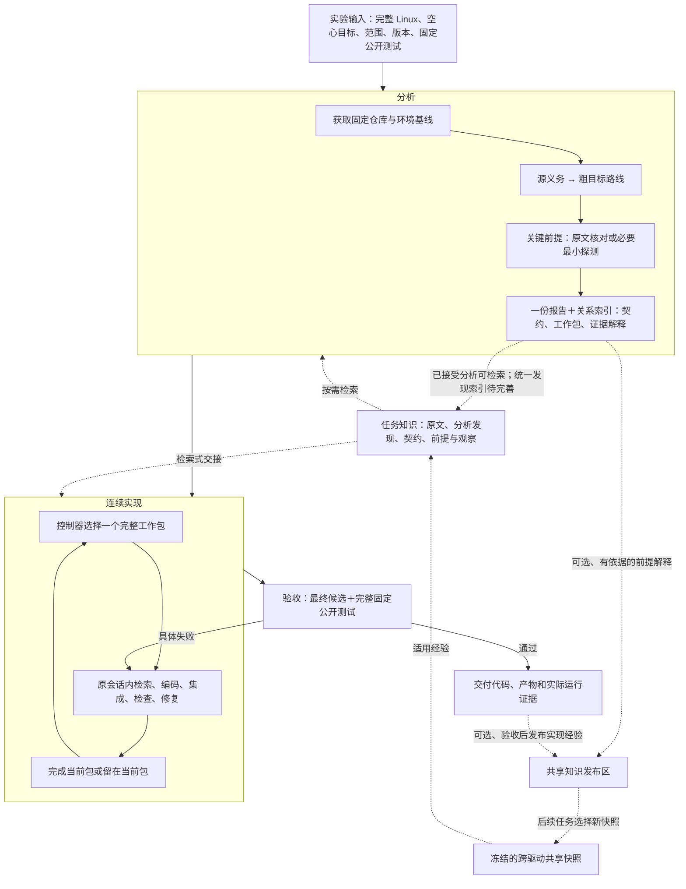

# Driver Port Factory：面向跨内核 C→Rust 驱动迁移的证据驱动工作流

**科研汇报稿｜架构、方法贡献与实验论证**

- 汇报对象：系统软件、软件工程与大模型程序生成研究团队。
- 工程依据：`driver-port-factory` 主分支 `605fdf4`，2026-10-04 核对；后续代码变更需重新核对对应表述。
- 研究目标：在完整源码上下文中，将 Linux C 驱动迁移到 Rust 目标内核，获得可集成、可执行、可验收的实现，并控制研究、交接和返工开销。
- 本文性质：已有系统的方法说明与科研论证框架，不是已完成的对照实验论文。正文明确区分已实现机制、已有局部观察与待验证假设。
- 术语：FSE 是软件工程学术会议；若面向 Industry Track，还需要真实工程场景、实际使用反馈和可量化工程收益，不能仅以工具复杂度或实验内核代替工业证据。

## 摘要

跨内核驱动迁移要求同时理解设备行为、源内核提供的保证和目标框架的职责。C 与 Rust 的语法对应只解决其中一部分：源驱动依赖的锁、回调、资源管理和错误传播机制可能在目标中由不同组件承担，编译成功也不意味着行为保持。通用 coding agent 能自主查阅代码、实现和测试，但任务范围、语义解释、进度与验收之间的联系，往往需要为具体项目额外组织。

Driver Port Factory（DPF）在通用模型之上构建一个可追溯的迁移流程。系统提供完整固定版本源码，以源行为义务形成粗粒度目标路线，只提前调查会改变接入方案的关键前提；同一份分析直接连接契约、工作包和测试解释。控制器按一个完整工作目标调度持续实现，在出现具体反证时局部修订，在同一最终候选上执行完整公开验收。知识库承载迁移过程中不断形成的知识：前期搜集的资料、源行为分析、目标 API 语义、映射依据和关键前提应成为后续工作者可按需检索的任务记忆，而不只存在于分析者的会话或长报告中。项目内知识传递服务当前实现与修复，跨驱动共享复用服务后续任务；历史结论不直接成为新任务正确性的凭证。

本文提出三项可检验的方法贡献候选：**贯穿分析、实现与后续任务的知识积累及检索式交接；源义务—目标职责—实现目标的关联表示；前提驱动的渐进调查与局部修订。**当前已经实现若干关键链路，但全部分析发现的统一检索仍需完善。三项贡献相对纯 Codex＋goal 的质量和成本优势需要公平对照、分别消融及独立质量判定。本文不将公开测试通过、结构校验成功或知识检索命中等同于完整语义等价。

## 1. 研究问题：驱动迁移为什么需要专门的方法

### 1.1 迁移对象是驱动与内核的协作关系

本项目中的迁移是 Linux C 驱动到 Asterinas Rust 内核的跨平台适配，不是保留原 ABI 的逐句转写，也不是仅以消除编译错误为目标的语言转换。

| 迁移维度 | 必须回答的问题 | 单看驱动文件容易遗漏什么 |
| --- | --- | --- |
| 设备行为 | 在给定状态和输入下，设备操作及结果是什么？ | 寄存器时序、队列协议、设备差异和恢复条件 |
| 源内核上下文 | 哪些保证来自调用者、公共子系统或配置？ | 回调上下文、对象存活、共享驱动核心和资源回收 |
| 目标平台集成 | 目标驱动、框架及上层调用者如何分担职责？ | 能编译但未注册、无法调用或生命周期不完整 |
| 跨语言表达 | 所有权、借用、共享可变状态和 unsafe 边界如何成立？ | Rust 类型合法但阻塞、错误或清理行为发生变化 |
| 运行验证 | 什么观测能区分正确实现与空实现或错误实现？ | 测例跳过、模拟接口与原生路径混淆、测试未真正驱动设备 |

因此，输入必须允许模型查阅**完整源内核**和目标框架。驱动入口是检索起点，不是阅读边界；知识库索引是导航工具，不是限制模型可见源码的白名单。

### 1.2 核心矛盾：信息必须连续，调查必须有边界

前期设计与实际迭代暴露了两个相反的问题。

一方面，过早开展全面平台调查，容易产出大量实现阶段不会使用的材料，而真正决定某个局部设计的信息仍需编码时查找。另一方面，如果把实现压缩为彼此孤立的小任务，源行为、调用前提和跨组件责任又可能在交接中丢失。

多阶段重复总结和过细工作包还会放大成本：同一源码被反复解释，局部 API 调整被提升为全局重新分析，模型需要不断恢复任务上下文。历史项目尚未发表；这些经历用于解释设计动机，不能替代系统实验，也不在本文中作为已测得的成本倍数结论。

DPF 的研究问题可以表述为：

> 如何在按需读取完整内核、持续实现的条件下，维持跨平台行为责任与验收依据的连续性，同时减少不必要的全面调查和无关返工？

### 1.3 研究问题与可观测结果

| 编号 | 研究问题 | 应观察的结果 |
| --- | --- | --- |
| RQ1 | 义务、职责与工作包的关联是否减少跨平台语义遗漏？ | 独立判定的残留缺陷、漏实现功能及其类别 |
| RQ2 | 关键前提和局部修订是否减少无关返工？ | 前置重开次数、受影响与无关行为的重做比例、修复成本 |
| RQ3a | 前期分析成果进入可检索任务记忆后，后续工作者是否减少重复调查并保持决策依据？ | 已有事实重查、知识采纳、语义遗漏、上下文与实现成本 |
| RQ3b | 带条件的共享经验是否真正促进跨驱动迁移？ | 经验实际使用、适用性错误、调研时间和最终质量变化 |
| RQ4 | 这些收益是否值得流程开销？ | 全任务费用、端到端时长、成功率、尾部开销及人工干预 |

## 2. 总体架构：三个宏观阶段与两类责任

### 2.1 正常执行路径

当前默认开发流程有十五个账本检查点，但**检查点不是十五次模型调用**。获取、登记、交接、构建和验收可以由程序执行。同一份联合分析登记为多个证据角色，不意味着模型需要生成多份研究报告。分析审阅与最终模型审阅默认关闭；最终公开验收仍然保留。

### 2.2 模型与控制器的分工

| 主体 | 主要职责 | 不应承担的职责 |
| --- | --- | --- |
| 模型 | 找代码、理解上下文、提出路线、解释语义、实现与修复 | 编造运行结果、修改固定断言使实现通过、自己宣布公开验收成立 |
| 控制器 | 管理版本与环境、投递工作包、保存进度、调用执行器、记录结果 | 仅凭引用存在、类型通过或哈希匹配宣称语义等价 |
| 操作者/独立评价者 | 固定实验输入与标准、建立外部质量判定、解释结果 | 把系统自身的 PASS 当成全部质量真值 |

这种分工让“模型认为完成”“控制器记录完成”“运行观察支持某项行为”成为可以区分的事件。其研究价值是让迁移失败可定位、改进可归因，而不是宣称程序能自动判断所有自然语言契约。

### 2.3 工程基座

系统以阶段依赖、类型化产物、SQLite 账本和内容寻址存储组织运行。模型调用、输入提示、检查日志、产物与结论可以追溯到具体任务与版本。平台执行被封装为显式接口，模型通过统一工具使用预先配置的 Docker、构建、QEMU 与测试入口。

这些设施支持复现、续跑和分析，属于必要工程基础。数据库、哈希、工作流状态机或容器本身都是成熟技术，不单独作为论文的主要创新点。

## 3. 核心贡献候选一：用行为责任组织跨平台迁移

### 3.1 功能对齐：从源行为出发，而不是从目标测试反推范围

功能对齐回答：**迁移后的驱动必须完成哪些事情？**

工作者从源入口、共享驱动核心、调用者及配置开始，识别冻结范围内的正常路径、提前返回、失败处理、状态变化和清理责任。目标测试能观察哪些行为，需要单独说明；测试覆盖不足不能自动缩减迁移范围。

一个源函数可以包含多项义务，一项义务也可能分散在多个函数和公共子系统中。功能对齐不要求保持函数数量或代码形状一致，而要求说明源义务在目标中的实现位置和边界。

### 3.2 语义对齐：追踪保证由谁承担

语义对齐回答：**同一个功能在什么条件下成立，其保证在目标中由谁提供？**

对于会影响正确性的适配，分析正文需要描述：源触发条件及结果、目标承担者、必要调用/生命周期前提，以及依据与限制。

| 示例义务 | 需要保持的语义 | 需要核对的目标职责 |
| --- | --- | --- |
| 获取资源失败时返回 | 失败结果、等待行为和状态副作用 | 目标接口是否可能阻塞、是否保留原先失败路径 |
| 设备事件访问共享对象 | 对象有效期及并发访问条件 | 驱动锁、框架回调约束和对象所有权分别保证什么 |
| 停止设备后释放资源 | 设备/回调不再访问已释放资源 | 停止、注销、同步等待和释放的顺序及前提 |
| 提交队列后等待完成 | 数据及 DMA 缓冲区在完成前仍有效 | 驱动与 virtqueue/DMA 框架之间的所有权转交 |

以上是说明机制的语义例子，不是已在所有实验驱动上确认的缺陷，也不是强制每个驱动执行的检查清单。

例如，若源路径在 `try_lock` 失败时立即返回，目标仅仅“使用了互斥锁”不足以支持等价：阻塞式获取可能改变进展条件。需要查目标定义与调用环境，再确定承担方式。相反，没有执行并发压力测试也不自动推翻已经有原文支持的互斥性质；应记录验证限制，只有影响正确性结论的具体前提缺口才继续调查。

### 3.3 一份表示连接分析与实现

当前实现用同一 Markdown 报告保存推理正文，用 `.route.json` 保存位置和关系：

| 对象 | 含义 | 连接方式 |
| --- | --- | --- |
| `C`：contract | 有源代码依据的行为义务及其解释 | 链接源位置，由工作包承担 |
| `R`：main_route | 目标接入的粗路径 | 被工作包及关键前提引用 |
| `P`：premise | 会改变接入方案的必要前提 | 连接路线与源码/观察依据 |
| `B`：behavior | 一个完整实现工作目标 | 连接路线、契约及必要依赖 |

可将这种表示抽象为图 `G=(C,R,P,B,E)`。这是本文对现有引用结构的描述，不是新增图算法。控制器校验引用关系、为当前工作包投影相关段落，并依据显式修改计算进度影响。

程序能够检查“每个已声明契约都连接到工作包”，却不能据此推出“所有源语义都已被发现”或“该工作包确实满足契约”。前者还需要独立的范围标注，后者需要源码论证和运行观察。

### 3.4 为什么比单独要求模型写契约更有研究价值

孤立的契约文档容易在编码时失去作用。DPF 的方法意图是让关联参与后续执行：分析直接形成初始工作计划，相关义务与前提进入当前工作包，发现反证后依关系更新进度，最终保留义务与验证限制的解释。

因此，待验证的贡献是**职责关联对执行过程的作用**，而不是契约条数更多。最直接的消融是保留同样的最终测试与分析预算，移除这些关联的工作包投影，观察语义遗漏与返工是否增加。

## 4. 核心贡献候选二：前提驱动的调查与局部修订

### 4.1 先形成可行粗路线，再解决决定路线的未知

分析顺序为：

> 源义务 → 粗目标路线 → 会改变设计的关键前提 → 查原文或最小观察 → 契约与完整工作目标。

关键前提应能说明：“需要确定事实 X；不同答案怎样改变路线或正确性结论；去哪里查看定义，或什么最小观察能回答它。”局部命名、辅助类型和文件布局通常在实现中处理。

这使调查具有结束条件：当前范围的必需结果、承担关系、验收解释和决定接入方案的前提已经明确，就进入实现。没有固定探测数量，也不因驱动存在锁或 DMA 就开展整个内核的全面调研。

### 4.2 工作包是完整目标，不是机械拆开的路线节点

控制器每轮选择一个完整目标；模型在同一会话内可以多次查源码、修改代码、构建和修复。`continue` 保持当前目标，`done` 最多推进一个目标。

对于简单内聚驱动，一个包可以同时包含注册、状态管理、事件处理、框架适配和清理。多个源函数、多项契约、三个测例或多个粗路线节点，都不强制产生多个工作包。对于复杂驱动，才按实质独立或较大目标建立多个包。

作用机制有两点：工作包限制当前工作范围，持续会话保存实现中间状态。不能宣称“会话复用”本身独有；Codex 也支持会话延续，DPF 的区别在于会话中的工作目标及其推进由显式计划约束。

### 4.3 用具体反证修订，而不是周期性重新审查

| 变化 | 当前处理原则 |
| --- | --- |
| 常规代码修改或补充观察 | 在当前目标内继续，不单独触发全局路线重审 |
| 当前目标不变，但目标 API/接入方式需要调整 | 当前实现行为处理，保留代码和无关进度 |
| 显式修改路线、前提或工作目标 | 按关联及依赖核对受影响行为 |
| 需要改变源义务或固定断言 | 显式契约/范围修订，不能借路线修改偷偷削弱要求 |
| 公开测试具体失败 | 返回相应失败事实并修复，不从头调查整个平台 |
| 只有临时路径、日志或报告位置变化 | 不作为重跑已经通过最终批次的理由 |

系统不使用自然语言相似度宣称语义不变，也不让每次文件变化触发广泛返工。这是一种可解释的进度管理策略，其有效性需要用实际误失效、遗漏依赖及修复记录评估。

### 4.4 成本优势的来源与边界

潜在节省来自减少重复调查、重复总结、过细交接和无关返工，而不是削减模型可以访问的代码。完整 Linux 是共同输入，工作包只投影当前相关内容，模型仍可按需搜索整个源树。

额外开销也必须计入：关系索引、提交格式修正、材料归档、知识索引、控制器检查和最终完整验收。DPF 可能在极小任务上比纯 agent 更贵；只有包含失败与修复的完整成本比较才能确定净收益。

## 5. 核心贡献：贯穿分析与实现的知识积累和检索式交接

### 5.1 知识库是信息传递的核心机制

本项目预期的知识库不只是外部文档搜索器，也不只是任务结束后的经验收藏。**前期模型调查得到的资料及有依据的分析，应沉淀成后续工作者可以检索的任务知识。**“未来工作者”首先包括同一驱动的实现、修复工作者和恢复后的新会话，其次才是下一驱动的工作者。

这种设计把分析的产出从一次性报告变为持续可用的研究成果。后续工作者在决定队列所有权、回调终止条件或目标接入方式时，应能够找到已经调查过的结论、依据和适用限制，继续完成当前目标；不必重新从完整源码中复原同一条推理链，也不需要每轮接收整份分析材料。

| 知识内容 | 生产者与时机 | 后续消费者及用途 |
| --- | --- | --- |
| 固定版本的原文资料和相关位置 | 初期资料收集与按需调查 | 各工作者定位定义、调用者和原始依据 |
| 源行为义务及上下文解释 | 源分析工作者 | 实现者理解必需结果、失败路径及隐含前提 |
| 目标 API 保证、调用限制和候选方案依据 | 目标研究工作者 | 实现者选择正确承担方式，避免重新调研或重复已排除路线 |
| 行为映射与关键前提 | 联合分析及必要探测 | 当前工作包、后续修复与会话恢复保持决策连续性 |
| 实现发现和实际观察 | 当前实现工作者与执行器 | 后续工作者定位具体问题；适用经验可供下一驱动检索 |

完整源树、研究知识和会话上下文分别承担不同角色：源码提供事实基础，知识库保存可检索的调查成果及出处，会话承载当前推理。知识库应连接而非替代另外两者。

**研究贡献的重点是知识如何被生产、传递并用于迁移决策，BM25 或向量只是访问方式。**“按需检索”表示低负担消费知识，不表示知识库在架构中不重要；不要求模型反复写报告，也不意味着应丢弃它已经完成的分析。

### 5.2 三层知识与两条复用轴

| 层次 | 内容 | 作用 |
| --- | --- | --- |
| 完整固定仓库 | 完整 Linux、对应空心目标和所需公开源码 | 自主调查任意相关定义和上下文 |
| 项目知识层 | 受控原文、当前已接受分析/契约、关键前提及观察 | 同一任务内跨阶段、工作包及会话传递知识 |
| 共享知识层 | 可复用原文、观察和有条件经验 | 跨驱动、跨任务积累可核对的知识 |

第一条复用轴是**分析 → 实现/修复**，即使第一次翻译、共享库为空，也应有价值。第二条复用轴是**当前驱动 → 后续驱动**，利用相同平台和相似机制的经验。这两条轴必须分别评价，不能仅通过关闭共享库来声称已消融知识库。

当前工作包直接提供必需义务和约束，知识库提供可按需展开的依据、上下文和已有发现。关键责任不能因检索漏召回而从工作包中消失；同时，不必将所有支持材料硬塞进每轮上下文。

索引没有覆盖某文件时，模型仍可以直接读取完整固定仓库。检索无命中不等于不存在相应 API 或没有做过相关分析。

### 5.3 预期机制与当前落地状态

| 链路 | 当前代码实际行为 | 与完整预期的关系 |
| --- | --- | --- |
| 资料 → 项目索引 | 受控原文进入项目索引，支持 BM25 和可选混合 RAG | 已实现原始资料的可检索保存 |
| 已接受分析 → 后续问题查询 | `problem_packet.accepted_rows()` 读取已接受契约和测试矩阵产物，切分并与源/目标/测试片段联合查询 | 同一份分析的相关内容可以进入后续查询；不是只有源代码检索 |
| 分析 → 工作包 | `route_model.packet()` 选择关联路线、契约和前提正文 | 已实现必需知识的定向传递，与按需检索互补 |
| 已支持前提 → 共享解释 | `route_learning.py` 选择性保存结论、条件和依据 | 支持后续任务复用，但当前任务不追随共享库新 HEAD |
| 实现发现 → 后续共享经验 | `knowledge_learn` 保存来源，公开验收后发布 | 已实现一条实现经验积累路径 |
| 全部有用分析发现 → 统一任务知识入口 | 当前报告查询、路线投影、原文索引和共享查询仍为不同路径 | 尚不能宣称全部发现自动统一索引、跨轮即时可检索或自动处理结论替代 |

因此，现状应称为“已有分析成果检索与知识传递链路，完整任务知识层尚需整合”，而不是“只做了外部 RAG”，也不是“已经自动记住所有分析”。`translation_facts.py` 的词法线索不是模型分析发现，不能拿它代替这项能力。

若补齐这条主线，应复用现有分析及源码引用，在接受分析/显式修订时更新任务内的发现视图，不增加独立总结模型。查询应能够定位结论及其来源、适用范围、未决条件和当前版本；新分析替代旧分析时保留历史，但当前查询区分有效与已替代结论。任务知识允许随本任务研究推进更新，外部共享快照仍保持固定，二者不能混为一谈。这是后续实现方向，本文修订不声称已经完成这些接口。

### 5.4 检索与生成如何连接

受控原文按来源及版本归档、切块。BM25 提供精确符号检索；可选本地 Sentence Transformers 向量与 BM25 通过倒数排名融合提供混合召回。检索返回有界片段、路径、行号、版本及实际模式，供当前模型判断和引用，不新增专职总结模型。

向量能力是可选配置，不能把所有运行都称为“使用了向量 RAG”。当前向量存储面向受控小语料，不是大规模 ANN 服务。查询重放和原文字节校验验证的是检索来源与可复查性，不证明检索相关性、模型实际使用或语义蕴含。

### 5.5 跨驱动积累的对象

共享库区分三类记录：

| 类型 | 保存内容 | 可支持的判断 |
| --- | --- | --- |
| `ORIGINAL` | 原始代码/材料、版本、来源与原文字节 | 指向具体定义或资料 |
| `OBSERVATION` | 实际检查、探测及相关日志 | 说明某次条件下观测到了什么 |
| `EXPERIENCE` | 问题、解释、适用条件、限制及原文/观察引用 | 为下一任务提供可核对的判断起点 |

经验不能靠引用另一条经验形成自证链；历史 PASS 不能直接传递为下一驱动 PASS。跨任务复用应复用“为什么、在什么条件下这样做”，不把旧候选代码当成当前任务答案。

当前有两条不同的发布路径，汇报中应准确区分：

1. **分析前提复用**：`route_learning.py` 可发布已支持前提的解释及原文/探测来源，标注为解释，不代表已完成驱动验收。
2. **实现经验复用**：`knowledge_learn(lesson, conditions, sources)` 保存实现发现，由 `learning.py` 在公开验收通过后发布；验收通过也不自动证明经验具有跨版本普适性。

新任务读取的共享快照固定，运行中不会因库更新而悄悄更换输入；发布区用于后续任务。发布失败仅记录未发布，不使已接受实现返工。

### 5.6 优势如何被证明

知识库的价值首先应通过“后续工作者是否正确利用前期分析”来证明，再通过“下一项任务是否正确利用经验”证明跨驱动效用，而不是通过条目数量或检索次数来证明。应同时测量：检索到适用证据的比例、实际采纳的决策、错误迁移经验的次数、调研/修复成本、最终质量。

旧研究中“预先整理很多资料但很少使用”的经验，暴露的是知识组织、交接和消费机制的问题，不能据此判定知识库价值低。当前目标是让已经完成的调查能在需要时被找到、理解和使用，减少无用的全面预研及重复写作。其相对普通搜索、报告交接或 Codex Skill 的收益需要独立对照。

## 6. 功能验收、语义论证和工业工程能力

### 6.1 三种结论必须分开

| 结论 | 主要依据 | 不应推出的结论 |
| --- | --- | --- |
| 已声明义务得到关联 | 分析关系和源码引用可追踪 | 所有源义务都已完整发现 |
| 某项保证有源码论证 | 原定义、承担者和必要前提 | 所有执行交错均已验证 |
| 某场景运行通过 | 固定刺激、断言和真实执行记录 | 未测试功能或全部硬件语义正确 |

公开测例之外的义务，保留有界源码论证和限制。一般性的“没有穷尽验证”不自动创建返修任务；具体违反路径或改变正确性结论的必要前提缺口需要处理。该边界防止语义分析变成无限主观审核，但不会把未知伪装成已证明。

### 6.2 收尾验收有明确终点

实现阶段可以使用既有检查记录；交付时控制器针对同一最终源码/产物完整执行固定公开集合，不能拼接不同开发时刻的单项 PASS。通过后正常结束，不额外启动模型确认，也不因恢复过程中的临时路径变化重跑。

预置断言由操作者管理，模型可以实现或适配驱动所需调用接口。工作包完成不等于驱动验收通过；测试接口覆盖和真实目标调用路径覆盖需要分别报告。

这里的“独立验收”主要指执行和裁定职责独立于工作者自述，**不等同于私有盲测**。公开测试已对模型可见，因此仍可能出现过拟合，必须另设外部质量评价。

### 6.3 更核心的工程优势

| 工程能力 | 对实际迁移工作的意义 | 证据边界 |
| --- | --- | --- |
| 固定输入、环境和真实执行路线 | 减少不同机器/版本差异造成的错误归因 | 尚需跨机器复现实验 |
| 环境基线与驱动行为验收分离 | 容器故障不应被当成驱动语义缺陷交给模型盲修 | 环境通过不能证明驱动通过 |
| 框架适配随完整目标完成 | 避免先实现孤立代码、后发现无法进入目标内核 | 需要实际入口和运行观察支持 |
| 状态、日志与候选可追溯 | 能定位哪个前提或修复造成了变化，支持续跑与审计 | 可追溯不等于结论正确 |
| 模型工具化接口 | 程序生成哈希、短引用和收据，减少协议填表负担 | 格式失败和工具开销仍需计量 |
| 公开迁移域与评价域分开 | 为封存候选及独立评估提供工程接口 | 当前开发权限不是严格隔离，接口存在不等于已完成盲评 |

这些能力构成可使用的迁移系统。工业价值需要通过任务完成、集成难度、定位效率和维护成本来证明，不能仅以模块数量衡量。

## 7. 与纯 Codex＋goal 等通用 agent 的公平比较

### 7.1 比较的层次

Codex 本身能查看完整仓库、编辑代码、调用工具、运行命令、延续会话，并通过 Skill 扩展工作流程；相关能力见官方 [CLI 文档](https://developers.openai.com/codex/cli/) 和 [Skills 文档](https://developers.openai.com/codex/skills/)，2026-10-04 查阅。

DPF 可以使用 Codex 作为模型执行后端。因此比较的实质是：**同等模型和输入条件下，通用自主执行与显式迁移控制方法的差异**，不是“两个模型谁更聪明”。本研究将 baseline 定义为纯 Codex＋goal；goal 的设置应在实验协议中明确，不能把普通 `codex exec` 自动记为已配置 goal 的运行。

### 7.2 机制比较

| 维度 | 纯 Codex＋goal baseline | DPF 当前方法 | 待检验收益/代价 |
| --- | --- | --- | --- |
| 源码访问 | 完整固定 Linux，自主搜索 | 同样完整源码，自主搜索＋可选索引 | 不靠裁剪输入形成成本优势 |
| 规划能力 | agent 自主决定计划与调整 | 源义务、路线、前提、工作目标显式关联 | 一致性增强，可能增加表示开销 |
| 语义调查 | 根据任务与代码自主展开 | 聚焦承担关系及设计关键前提 | 可能减少遗漏和泛化调查；不能保证完整 |
| 实现粒度 | agent 自主决定 | 每轮一个完整包，小驱动可一个包 | 范围更稳定；过细规划会适得其反 |
| 会话与修复 | 可以保留会话、自主迭代 | 持续实现会话＋进度及影响关系 | 价值来自调度规则，不是会话能力独有 |
| 分析成果传递 | 可读报告、保留会话、自行组织笔记和检索 | 已接受分析与原文联合查询＋当前工作包必需知识投影 | 评价后续工作者是否少重查、少遗漏；不能声称通用 agent 没有记忆 |
| 跨任务知识 | 能用搜索、文档、Skill；纯 baseline 不附加 DPF 共享库 | 有来源、适用条件和固定读快照的跨驱动积累 | 与任务内分析复用分开消融 |
| 停止与验收 | goal 完成必须同样由外部公共工具判定 | 控制器运行同一最终候选的固定公开集合 | 两组应使用同样强度的外部裁定 |
| 实验环境 | 相同 Docker、内核、设备和测试 | 相同环境，通过控制器接入 | 不能将更好的环境只提供给 DPF |
| 工程开销 | 起步轻，流程灵活 | 额外材料、索引、协议与状态管理 | 小任务可能无净收益 |
| 可审计性 | 可以保存对话、命令和工具结果 | 预定义产物关系、来源和结果账本 | 比较归因效率，不声称 baseline 无日志 |

通用 agent 通过充分工程化也能实现这些规则。如果 baseline 已加入相同契约、知识和控制器，它就不再是“纯通用 agent”；这应作为增强基线或消融单列。反过来，只给纯 baseline 很弱的提示或缺少工具，也不能说明 DPF 的方法有效。

### 7.3 当前最有希望形成优势的场景

- 驱动依赖较多公共内核语义，源保证在目标中由不同框架承担。
- 实现中需要调整目标集成路线，但源功能范围应保持稳定。
- 同一平台上持续迁移多个驱动，前提、错误模式与资料具有复用价值。
- 环境、产物和失败归因较复杂，需要支持可复现交付与多人协作。

可能优势较弱的场景包括：非常小且 API 直接对应的驱动、一次性任务、目标支持极其成熟、没有可迁移经验、或格式与索引开销高于实际编码成本的情形。这些任务也应纳入评价，不能只挑选有利案例。

## 8. 创新定位：主贡献、支撑设施与已有技术

| 层次 | 可以提出的贡献 | 相对已有技术需要证明的增量 |
| --- | --- | --- |
| 方法贡献候选 M1 | 将分析产出的资料、语义解释及依据组织为可检索任务知识，并支持条件化跨驱动积累 | 在同等信息下，检索式交接比报告交接或会话记忆减少重复调查及决策丢失 |
| 方法贡献候选 M2 | 将源义务、目标职责、关键前提与完整工作包联合用于执行 | 不只是生成契约文档；关联实际减少遗漏或改善修复 |
| 方法贡献候选 M3 | 由关键前提驱动调查，并基于显式依赖局部修订 | 不只是常规计划；减少无关返工且不增加漏修 |
| 系统贡献 | 在真实内核集成、受控环境和固定验收中实现上述方法 | 端到端可用，边界清楚，失败和开销可报告 |
| 实验贡献候选 | 完整输入、单驱动移除、正负控制及公平 baseline 的实证研究 | 待正式执行与独立评价后才能成立 |

BM25、向量检索、RRF、Skill、持续会话、Docker、CAS、状态机、测试与 reviewer 都不宜单独包装成新发明。本文也不声称首次使用契约或首次开展知识增强迁移。真正的新颖性需要系统比较已有 LLM 迁移、契约引导、仓库级 agent、跨平台适配和记忆复用工作后确定。

建议对外使用的贡献表述：

> 我们研究跨内核驱动迁移中，源行为保证如何在有限任务上下文和渐进实现中持续传递。DPF 将有来源的行为义务、目标承担关系、关键前提与实现目标关联，并将调查中形成的知识保存为后续工作者可检索的任务记忆。检索式交接与工作包责任投影共同保持决策连续性，局部修订和条件化跨驱动积累支持渐进实现；统一运行验收用于评价实际效果。

这是一项可检验的研究主张，而不是已经证明优于所有通用 agent 的结论。

## 9. 已有依据与尚缺的证据

### 9.1 当前可以报告的事实

| 内容 | 当前依据 | 可报告结论 |
| --- | --- | --- |
| 分析成果的后续查询 | `problem_packet.py` 将已接受分析产物和受控代码片段联合检索 | 任务内知识复用链路已存在；全部发现统一检索尚待整合 |
| 路线关联、工作包与局部修订 | 已有生产代码及相关离线检查 | 机制已实现；不自动推出端到端收益 |
| BM25＋可选混合 RAG | 检索实现及 86 片段、6 个问题的开发探针 | 混合检索具备运行依据；样本过小，不作为质量提升结论 |
| evbug、NE2000 迁移 | README 记录两项 Luna medium 运行完成最终公开三项测试 | 有端到端可行性观察；不构成相对 Codex 的对照优势 |
| 原生四驱动实验环境 | RNG、Block、Network、NVMe 正向/空心负向控制及执行适配 | 环境和 oracle 可用于正式研究；没有模型翻译结果 |
| 完整 Linux 输入 | 新环境树与固定上游 Git tree 一致，96,034 个文件 | 源上下文完整提供；不证明模型充分理解或使用 |
| 跨驱动经验机制 | 归档、查询、快照和发布路径已接通 | 尚缺新版、受控的真实跨驱动收益评价 |

原生套件此前发布过裁剪 Linux 输入，现已修正。正式实验应使用修正后的完整源码版本，不把旧裁剪输入视为等价输入。早期 evbug、NE2000 与已核对 pvpanic 实验工作树均包含完整 Linux；它们与新原生套件使用的版本不同，不能直接混成同条件统计。

知识检索开发探针中 BM25 文件 hit@5 为 5/6、hybrid 为 6/6，同时存在个别问题排序退化。它只能说明检索实现有局部观察，不能写成“RAG 已提高驱动翻译成功率”。详见原始 [RAG 记录](../knowledge/RAG.zh-CN.md)。

### 9.2 尚不能作为汇报结论的说法

不能声称已实现完整语义等价、已经证明降低成本若干倍、优于 Codex、无需人工介入、适配任意内核/设备、覆盖所有并发恢复路径，或者已经满足 FSE 录用要求。

目前最实质的缺口是：正式同条件 baseline、机制消融、独立缺陷评价、跨驱动经验适用性评价，以及更有代表性的工程任务。历史运行中的人工修复环境、续跑和工具调整也必须如实纳入实验记录。

## 10. 如何用实验支撑这些优势

### 10.1 共用实验条件

使用同一 Linux revision、同一原始 Asterinas commit 派生的单驱动空心目标、同一官方 Docker 镜像及实际 QEMU/固件身份、同一设备配置与原生测试。所有方法都能读取完整源内核，自主查找上下文。每项只移除一个驱动，保留必要框架。

完整原始目标先通过正向控制；空心目标能构建、启动而设备 oracle 失败。模型工作区只包含所选空心目标，不能读取其他任务中保留的原 Rust 驱动。干净 Git 导出还需配合工作者权限或独立机器隔离；开发模式的广泛宿主权限不足以证明无泄漏。

固定模型、推理强度、上下文配置、权限、预算、网络访问规则和公共工具；运行顺序随机化或交错，预先规定重复次数和失败分类。纯 Codex＋goal 同样获得构建与验收工具，不要求它重建实验基础设施。

### 10.2 对照与消融

| 组别 | 配置 | 回答的问题 |
| --- | --- | --- |
| G0 | 纯 Codex＋goal＋完整源码＋共同环境/测试 | 通用自主执行能达到什么水平？ |
| G1 | G0＋同等迁移说明/Skill，不加入 DPF 控制器 | 改善是否仅来自领域提示词？ |
| G2 | DPF，无跨驱动经验，保留当前项目材料 | 核心迁移控制方法是否有独立收益？ |
| G3 | DPF＋预先冻结、任务外来源的共享经验 | 跨驱动积累带来多少增益？ |
| 消融 A | DPF 保留分析与验收，取消职责关系的工作包投影 | 提前传递责任是否必要？ |
| 消融 B | 保留关系与验收，关闭局部修订策略 | 收益是否来自避免无关返工？ |
| 信息匹配对照 | 向通用 agent 提供相同经验材料/检索入口 | 优势来自额外信息还是使用机制？ |

主比较先开展 G0 与 G2，同时将下面的任务内知识消融列为核心实验，不能只把 G2/G3 的共享库比较当成全部知识贡献。其余组按研究问题安排。默认不启用模型 reviewer；若研究 reviewer，单独列组，不能把额外审阅算力混入主方法而不计成本。

### 10.3 核心知识消融：拆开信息、组织和检索的贡献

任务内消融固定模型、完整源码、同一份前期分析产出、工作目标、必需契约及测试；先关闭跨驱动共享经验，避免把两个效应混在一起。

| 组别 | 提供给后续工作者的分析知识 | 要回答的问题 |
| --- | --- | --- |
| K0：普通报告交接 | 相同分析报告保存在文件中，可自主搜索和阅读；保留必需契约与工作包 | 通用文件和会话工具能否足够完成交接？ |
| K1：仅原文检索 | K0 加原始代码/资料索引，不提供分析结论的专门检索入口 | 收益是否只来自更快搜索代码？ |
| K2：任务知识检索 | K1 加已产生分析发现及依据的按需检索 | 前期研究的检索式复用是否减少重查与语义遗漏？ |
| K3：任务知识＋共享经验 | K2 加固定、任务外的跨驱动经验 | 跨驱动积累在任务内复用之外有多少增益？ |

这些是实验干预定义，不表示当前已经存在四个一键开关。现有分析产物查询可作为 K2 的起点；若以统一发现索引为论文方法，应先补齐并冻结实现后再评价。去除该查询时仍保留普通报告文件、完整源码和必要工作包约束，不能用故意剥夺信息制造弱基线。

还可将“相同报告全部注入每次上下文”作为高成本交接对照，区分检索式交接与单纯多给信息。BM25/hybrid 对比是次级检索消融，不能取代 K0/K1/K2 的核心机制评价。

首先做**固定前期产出的后续实现对照**：对同一份分析复制独立实现工作区，比较不同知识访问方式，减少上游分析质量差异。随后做**端到端对照**：把资料准备、分析、建库、查询、失败修复及最终验收全部计入费用。前者识别交接机制，后者判断整套方法是否值得成本。

主要指标包括：已存在知识的重复调查次数与 token、第一次找到相关结论的时间、发现被采纳后是否正确、前提被遗忘或误用导致的缺陷、后续实现成本及最终独立质量。重复调查须区分合理复核与无效重做：版本/条件变化引发的重新核对不计为浪费。不能只依据引用次数判断知识有效。

实验中禁止把另一组实现发现即时回流到共享库；K3 的历史快照预先固定。单次任务自己形成的新知识属于其可演进状态，与外部知识泄漏不同。

### 10.4 指标与质量真值

- **质量**：公开完整验收、独立测试结果、残留真实缺陷、源义务遗漏、目标集成缺陷，分别统计。
- **语义覆盖**：以外部标注的范围内义务集合为分母；区分有运行观察、仅有合理源码论证和仍不支持。不能用模型自己列出的契约总数作为全部语义分母。
- **效率**：所有成功/失败调用的非缓存输入、缓存输入、输出和费用；构建、QEMU、索引及模型服务时间；总墙钟时长及人工介入。
- **返工**：具体触发原因、被重开的工作目标、无关进度重做、格式恢复和重复检查。
- **知识效用**：检索命中、决策引用、采纳正确性、错误复用及适用条件检查；自动日志只能说明访问，不能独立证明因果贡献。

使用独立判定和盲化裁决建立缺陷标签，记录分歧与解决办法。报告成功率、配对差异、分布和置信区间，不只展示最好案例。若同一时间既包含模型等待又包含工具运行，成本分解应避免重复计算，端到端时间单独照报。

## 11. 面向 FSE/工业评审的主要质疑与回答

| 质疑 | 当前可以给出的回答 | 仍需补齐的证据 |
| --- | --- | --- |
| 这是否只是普通 coding agent 外面套流程？ | 模型相同；方法对象是跨平台职责关系如何进入调度和修订 | 关系投影、局部修订的消融及独立质量收益 |
| 是否只是更长的 prompt 或加了 Skill？ | 说明被编译为可执行的引用和进度约束，但提示也可能贡献收益 | 同等说明的强 baseline，统一信息和预算 |
| 是否只是普通 RAG？ | 研究对象包括前期模型生成的分析知识如何带着依据传给后续工作者；不只检索外部文档 | 相同报告下的 K0/K1/K2 对照，再用 K3 识别跨驱动复用 |
| reviewer 是否才是效果来源？ | 正常开发路径默认无模型 reviewer | 实验冻结 reviewer 关闭，公开配置及调用账单 |
| 所谓语义对齐是否只是主观文本？ | 文本负责解释，程序仅保证引用和进度；不声称形式证明 | 独立义务标注、缺陷判定及具体成功/失败案例 |
| 是否为了便宜缩减输入或功能？ | 两组提供完整 Linux，冻结行为范围，测试不足不自动排除义务 | 输入树身份、范围审计、独立未覆盖行为评价 |
| 几个 QEMU 驱动能否代表工业场景？ | 能提供可复现基础，但不能代表所有设备与真实部署 | 合作项目、维护者评价、复杂任务或实际硬件证据 |
| 知识库是否泄漏答案？ | 读快照与发布分离，原实现及私有测试禁止进入实验输入 | 快照清单、跨任务隔离、知识来源审计 |
| 控制器是否制造更多错误和成本？ | 当前设计减少强制拆分与反复确认，额外开销照报 | 包括协议失败、人工介入和长尾任务的完整统计 |

如果优势仅体现在可复现性，论文应收缩为相应系统/经验贡献；如果语义缺陷并未减少，就不能继续以“更强语义保持”作为主要结论。FSE 的竞争力来自问题清晰、相对已有工作的实质增量和可靠证据，架构本身无法保证录用。

## 12. 科研汇报的组织建议

建议按 18 页、约 25–30 分钟组织口头汇报，正文可作为讲稿和问答材料。

| 页 | 标题 | 本页要传达的信息 |
| --- | --- | --- |
| 1 | 研究目标 | 完整内核上下文中的可运行跨平台驱动迁移 |
| 2 | 为什么语言翻译不够 | 设备、调用者和内核框架共同承担行为保证 |
| 3 | 研究矛盾 | 全面预研昂贵，小上下文交接易丢职责 |
| 4 | 总体架构 | 分析、连续实现、验收；模型与控制器分工 |
| 5 | 方法表示 | C/R/P/B 关系及同一份分析 |
| 6 | 功能对齐 | 范围来自源义务，测试不反向缩减范围 |
| 7 | 语义对齐 | 用非阻塞获取或生命周期例子解释责任转移 |
| 8 | 渐进调查 | 只提前解决会改变路线的关键前提 |
| 9 | 连续实现 | 完整工作包、同一会话、按需框架适配 |
| 10 | 局部修订 | 反证驱动变化，保留无关进度与代码 |
| 11 | 核心贡献：检索式交接 | 分析产生知识，后续实现/修复按需取用；现有链路与待整合部分 |
| 12 | 两条知识复用轴 | 同一任务跨工作者传递与跨驱动积累，分别消融 |
| 13 | 运行验收 | 同一最终候选，完整固定集合，有明确终点 |
| 14 | 与通用 agent 比较 | 同等模型与工具，比较迁移组织机制 |
| 15 | 创新定位 | 三项贡献候选及已知组件的边界 |
| 16 | 当前依据 | 可行性观察与尚缺对照严格分开 |
| 17 | 实验计划 | 强 baseline、消融、独立质量与完整成本 |
| 18 | 工程价值与开放问题 | 可集成、可追溯、可积累；不预支性能结论 |

汇报收束陈述：DPF 的目标是将通用 agent 的代码能力组织成能够持续承担源行为义务的迁移过程；研究要验证的是，这种组织在真实任务中是否比通用自主执行更可靠，以及收益是否值得其额外成本。

## 附录 A. 主要实现依据

以下路径相对本文件，便于报告审阅时从主张追到代码。

| 机制 | 实现/协议 |
| --- | --- |
| 完整固定源码获取 | [baseline.py](../../src/driver_port_factory/acquisition/baseline.py)、[repository_storage.py](../../src/driver_port_factory/acquisition/repository_storage.py) |
| 原生套件完整源码与任务导出 | [prepare.py](../../scripts/native_experiment/prepare.py)、[export-task.py](../../scripts/export-task.py)、[完整源码快照](https://github.com/C2R-Driver/driver-experiment-env/tree/5269173/source/linux) |
| 联合分析与语义责任提示 | [analysis-task.md](../../src/driver_port_factory/data/prompt-packs/default/analysis-task.md) |
| 路线、契约和工作包关系 | [route_model.py](../../src/driver_port_factory/migration/route_model.py)、[route.py](../../src/driver_port_factory/migration/route.py) |
| 当前工作包调度与局部适配 | [behavior.py](../../src/driver_port_factory/migration/behavior.py)、[local_adaptation.py](../../src/driver_port_factory/migration/local_adaptation.py) |
| 按前提最小探测 | [route_probe.py](../../src/driver_port_factory/migration/route_probe.py) |
| 已接受分析与代码的联合查询 | [problem_packet.py](../../src/driver_port_factory/knowledge/problem_packet.py)，`accepted_rows/query/assemble` |
| 检索、混合召回、向量配置 | [rag.py](../../src/driver_port_factory/knowledge/rag.py)、[ranking.py](../../src/driver_port_factory/knowledge/ranking.py)、[semantic.py](../../src/driver_port_factory/knowledge/semantic.py) |
| 共享库、快照和条件化经验 | [shared.py](../../src/driver_port_factory/knowledge/shared.py)、[shared_binding.py](../../src/driver_port_factory/knowledge/shared_binding.py) |
| 两条经验发布路径 | [route_learning.py](../../src/driver_port_factory/knowledge/route_learning.py)、[learning.py](../../src/driver_port_factory/knowledge/learning.py) |
| 固定断言与共同执行层 | [public_tests.py](../../src/driver_port_factory/platform/public_tests.py)、[native_runner.py](../../src/driver_port_factory/platform/native_runner.py) |
| 同一候选原生完整验收 | [check.py](../../scripts/native_experiment/check.py) |
| 正常路径和阶段边界 | [阶段指南](../workflow/STAGE_GUIDE.md)、[架构](../workflow/ARCHITECTURE.md)、[最终工作包交付](../workflow/FINAL_PACKAGE_HANDOFF.zh-CN.md) |
| 现有验证与限制 | [环境审计](../audits/NATIVE_ENVIRONMENT_20261004.md)、[RAG 开发探针](../knowledge/RAG.zh-CN.md)、[项目 README](../../README.md) |

## 附录 B. 论文撰写前需要完成的相关工作定位

应建立可追踪的文献矩阵，覆盖传统 C→Rust 转换、LLM 仓库级迁移、跨平台 API 适配、契约引导生成、agent 规划与局部修复、检索/记忆增强及系统软件测试。逐项记录已有方法是否具有职责承担关系、实现时传递、局部修订、知识条件与外部验收，并核对其真实实验设定。

本文尚未完成这一系统文献比较，因此“贡献候选”不能改写为“首次提出”。后续优先补充与最相近方法的区别，而不是继续增加流程环节或扩大文档数量。
