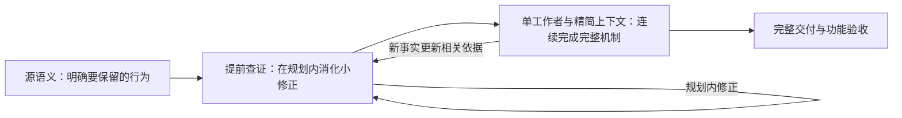

# v3 的设计思想、问题解决机制与四个核心问题的回答

合作方视察补充材料｜2026 年 10 月 12 日｜配套[汇报正文](PARTNER_VISIT_BRIEFING.zh-CN.md)

全文围绕 v3 的三个特点展开：**提前消化大返工、从功能对齐推进到语义对齐、单工作者以精简上下文完成完整机制。** 每个主题先说明原理，再分别展开例子；原始证据集中放在文末，供准备追问。

## 一、三项核心设计思想

### 1. 前置消化返工，争取首次完整交付通过

#### 原理

驱动实现依赖先前确定的行为边界、目标接入方式和状态资源设计。越早核对这些决定，越容易在当前范围内完成修正，后续工作也越能建立在稳定的保证上。

v3 因此主动寻找**规划反例**：核对当前方案成立所必需的事实，使用原始定义或必要的最小运行观察，判断方案是否满足条件。发现冲突，就在当前阶段调整方案，再推进后续实现。

整个过程在三个位置消化问题：联合分析核对会改变设计的前提；完整工作包连续处理具体适配和设备反馈；依赖协调更新受影响目标的依据，保留已经成立的实现。这样将跨越多个阶段的大返工，转化为范围集中、上下文完整的小修正。

设计目标是 **pass@1：争取首次完整交付通过既定验收**。规划核对和包内开发检查用于交付前消化返工。请求、完成、错误、恢复与清理在整体设计中共同安排，有助于形成状态一致、职责明确的系统级代码。

#### 例子 A：pvpanic 提前核对原生终止机制

目标终止机制只接受首次注册的处理器。v3 在规划中核对这一事实，选择在原生终止动作之前插入设备通知，明确了通知与实际终止如何配合。

实施阶段又在首次构建前核对通知路径的共享状态，统一安排非等待行为。接入与同步方案在相关实现进一步依赖它们之前确定下来。[证据入口 B](#evidence)

#### 例子 B：NE2000 提前核对硬中断与外层锁

NE2000 的发送、接收与中断共同使用设备状态。v3 分析先核对目标同步机制，明确禁用软中断的外层锁与硬中断之间的关系，再安排核心状态和中断访问方式。

后续设备运行取得的缓冲区与分配事实，也在同一个完整目标内进入实现和前提修订。最终探测、收发与恢复三项检查通过。[证据入口 D](#evidence)

### 2. 从功能对齐推进到语义对齐，让实现贴合原驱动

#### 原理

测例通过具体刺激和断言，确认设备在指定场景下实现了预期功能。语义对齐进一步从源驱动及相关调用方明确：**什么条件下应当产生什么结果，以及结果依赖哪些保证**。行为契约用于持续保留这些要求，并交给实施者。

契约覆盖正常行为，也保留早返回、等待、错误传播、数据所有权、完成与资源释放条件。目标平台可以采用合适的结构和机制，实施与修订都需要解释这些要求如何成立。

两者形成明确分工：测例提供执行观察，契约提供实现和核对的源语义依据。契约还能指导针对性场景，使验证持续围绕原驱动的行为组织。语义条件越早明确，越容易在规划时发现反例，并进入统一的系统设计。

#### 例子 A：pvpanic 的通知功能与非等待语义

设备收到通知，确认了通知功能。源契约进一步要求：获取锁失败时立即返回，通知路径保持非等待条件。

v3 将该条件交给完整通知目标，统一处理通知分发和事件状态，并实际运行持锁时抑制通知的检查。源条件、实现与针对性观察形成连续链条。[证据入口 B](#evidence)

#### 例子 B：RNG 的读取功能与完整读取语义

取得随机数据，确认了读取功能。源驱动与共享调用方还共同规定短读、缓存补充及阻塞／非阻塞行为。

v3 将这些要求映射到目标驱动和调用方，并纳入同一个完整数据服务目标，使读取设计始终贴合整条源调用链。[证据入口 A](#evidence)

#### 例子 C：NVMe 的读写功能与请求所有权

写入后读回的数据匹配，确认了设备读写。行为契约进一步约束请求数据保持到完成或安全取消，恢复与重试持续维护原请求的数据及唯一完成责任。

v3 的实际计划将底层队列和上层请求的责任连接起来，使正常路径、恢复路径与资源生命周期共同服务这些要求。[证据入口 F](#evidence)

### 3. 单工作者以精简上下文连续完成完整机制

#### 原理

一个规定范围内的完整机制，由一个工作者连续负责。必要的查阅、驱动实现、框架适配、调用方接入、检查与修正都在当前目标内推进，工作者保留设计决定和设备反馈，直接协调相关修改。

这里的高耦合，是将共同决定正确性的状态、资源和行为集中处理。同一机制的相关决定在同一上下文中形成一致安排，支持连续实现效率。

上下文围绕当前范围组织：提供当前目标所需的源行为、目标接入方案和关键事实，相同原文复用一次，原始材料按需读取。总体方案提供接入方向，当前目标确定现在要完成的机制与开发检查。

机制内部保持较少交接边界，使编译和设备观察直接服务后续设计。投入集中在实现本身，减少重复理解、交接摘要、计划协调与上下文重建。小驱动可以保持一个包；较大驱动在完整能力之间建立必要边界。

#### 例子 A：RNG 的完整数据服务由一个包承担

RNG 的设备接入、缓存、数据补充、完成通知与读取共同组成数据服务。实际 v3 计划将它们交给一个包，工作者可以在同一目标内协调驱动和调用方，并沿真实入口检查行为。[证据入口 A](#evidence)

#### 例子 B：igb 用两个包管理能力递进

igb 的基础网络服务与双队列扩展分为两个包。每个包内部都拥有实现其能力所需的状态、资源和生命周期，后继包通过明确保证复用前置能力。

这样既集中处理机制内部的紧密联系，也能用较少的目标边界管理更大的驱动。[证据入口 E](#evidence)

### 4. 三项思想怎样组成整个流程

#### 原理

先根据源语义明确要保留的行为，再提前查证会改变方案的条件，随后由单工作者以精简上下文连续完成机制。新事实在当前范围内进入方案和代码，已有工作继续使用，最后对完整交付候选统一验收。

## 二、结合 v3 的三个特点，解释我们怎样解决实际迁移问题

主汇报中的案例揭示了一个共同困难：**迁移中的关键决定相互依赖；一个条件较晚被发现，就可能要求重新调整已经形成的实现。** RNG 涉及设备与调用方的配合，网卡涉及权限、协议和中断，NVMe 涉及正常请求与恢复之间的数据保持。

v3 从三个方向组织解决过程：**让问题更早被发现，让实现始终围绕源语义，让相互关联的决定由同一工作者连续完成。** 三个特点共同服务于减少返工、争取首次完整交付通过，以及形成一致的系统级设计。

| v3 的特点 | 日志中对应的实际问题 | 设计着力点 |
| --- | --- | --- |
| **前置消化返工** | RNG 的调用方缓存、网卡的权限与协议条件在实现后才补齐 | 在规划时找反例，把会改变设计的问题提前处理；具体反馈在当前包内消化。 |
| **从功能对齐推进到语义对齐** | evbug 的样例通过后仍需补查事件表示；NVMe 的正常读写通过后，恢复修改可能覆盖待写数据 | 以源驱动及相关框架的行为指导设计，测例用于确认具体功能表现。 |
| **单工作者、精简上下文、完整机制** | NE2000 的权限与分配调整相互影响；v1 的真实设备反馈跨越实现和产物阶段，v2 的摘要交接曾丢失源条件 | 把紧密相关的决定放在同一实施范围，减少内部边界和重复理解，用连续反馈推进完整能力。 |

### 1. 前置消化返工：把后期推翻方案，转化为前期小修正

#### Codex 实际遇到了什么问题

RNG 在设备实现形成后，才通过读取检查补齐共享调用方的缓存行为；VirtIO 网卡在收发运行中分别修正访问方向，后续又调整现代设备要求的报文头布局。

这些问题影响的是调用链、缓冲区使用和数据解释。发现时，相关实现已经存在，需要重新调整。日志反映的动机因此是：**怎样更早核对会改变设计的条件，减少后续阶段对已有方案的推翻？**

#### 原理：规划时主动找反例，实施时在当前范围消化反馈

v3 在确定方案时，先问“这个方案要成立，哪些事实必须为真”，再查原始定义或取得必要的最小观察。例如，目标是否真的会调用新注册的处理器，缓冲区是否允许当前访问方式，锁是否屏蔽实际发生的中断。

核对顺序跟随设计影响：先明确会改变接入方式、状态组织和资源归属的条件，具体方法与编码细节在实施中按需解决。这样可以在大规模实现依赖某个决定之前，用一次小范围核对完成方案调整。

实施中的新事实也由当前工作者集中处理，相关代码与方案一起更新，已成立的部分继续使用。**前期的小修正和包内的小返工，共同降低跨阶段重新理解、重新规划和重新实现的需要。** 目标是争取 pass@1，并让系统结构在交付前形成一致安排。

#### 例子 A：VirtIO 网卡——先确定收发所依赖的协议条件

**Codex 的过程。** 实际补丁先后纠正接收和发送的设备访问方向，后续将现代配置要求的报文头从 10 字节改为 12 字节。权限和布局在设备运行后才逐项进入正确实现。[依据 C2](PARTNER_VISIT_EVIDENCE.zh-CN.md#c2)

**v3 的安排。** 实际规划提前明确接收缓冲区由设备写入，并按固定现代设备配置核对 12 字节报文头。缓冲区方向、数据布局与收发接入一起指导后续网卡实现。[证据入口 C](#evidence)

这个例子体现的是发现位置的前移：将会改变收发实现的决定，先在规划范围内核对清楚。

#### 例子 B：pvpanic——在接入之前确定终止路径怎样配合

目标终止机制只接受首次注册的处理器。v3 规划先核对这一事实，选择在原生终止动作之前插入设备通知。

实施又在首次构建前检查通知所访问的共享状态，统一安排非等待行为。后续原生 panic、关机和生命周期检查通过。[证据入口 B](#evidence)

接入与同步条件在进一步依赖这些决定之前得到处理，展示了“小范围查证—调整方案—继续实现”的过程。

#### 例子 C：NE2000——把设备反馈留在完整机制内部处理

v3 在实施前明确外层网络锁与硬中断的关系，安排核心状态和中断访问方式。设备运行所得的缓冲区与分配事实，也在同一工作包中进入实现和后续方案；该目标连续完成，最终探测、收发与恢复三项通过。[证据入口 D](#evidence)

这个例子体现的是返工范围的收敛：相关事实、代码和进度在当前机制内协调，后续工作可以直接沿用更新后的方案。

### 2. 语义对齐：让翻译结果贴合原驱动的行为

#### Codex 实际遇到了什么问题

evbug 的三项公开检查通过后，Codex 继续源码自查，发现目标事件表示还需要扩展。NVMe 的正常读写检查通过后，新增恢复逻辑曾借用请求数据缓冲区执行设备识别，可能覆盖待重试写入的数据；模型随后发现并分离缓冲区。

这些过程说明：**已执行场景的成功，与源驱动在其他触发条件下应有的行为，需要分别核对。** 正常功能、错误处理、并发和生命周期之间的关系，都要进入迁移设计。

#### 原理：用源语义指导设计，用测例确认功能

v3 先从源驱动、共享框架和实际调用方明确“什么条件下，应产生什么结果”。其中包括数据保持、等待与立即返回、事件顺序、请求完成以及资源释放。

行为契约是保留这些要求的载体。它把原驱动的行为持续交给实施者，使实现、自查和后续修改始终围绕同一语义目标。目标平台可以采用合适的结构，各项行为由目标驱动、框架或调用方共同承担。

测例进一步观察具体功能是否成立。**源语义决定设计应满足什么，测例确认已执行场景表现如何。** 两者共同使翻译结果贴合原驱动，并让正常、错误和清理路径在整体设计中统一安排。

#### 例子 A：RNG——从“能读出数据”到完整读取行为

**Codex 的过程。** 多项检查通过后，缓存预热后的非阻塞读取出现返回长度不符。模型追查 Linux 共享随机数框架，再补上调用方缓存及其补充时点。[依据 C1](PARTNER_VISIT_EVIDENCE.zh-CN.md#c1)

**v3 的安排。** 实际计划从设备数据补充一路覆盖到调用方读取，明确短读、阻塞／非阻塞行为以及真实设备入口，由同一个完整数据服务包承担。[证据入口 A](#evidence)

这里保留的是整条读取路径的行为。设备完成数据传输与调用方完成用户读取，需要共同满足源系统的配合关系。

#### 例子 B：pvpanic——从“收到通知”到“在正确条件下通知”

历史 v2 已读到源驱动获取锁失败时立即返回，交接摘要却只保留锁保护与串行化，目标随之采用等待锁。[依据 V2-A](PARTNER_VISIT_EVIDENCE.zh-CN.md#v2)

v3 将非等待要求持续交给完整通知目标，实现统一处理通知及共享事件状态。实际五项内核测试全部通过，其中包括持锁时抑制通知；原生 panic、关机与生命周期也有执行证据。[证据入口 B](#evidence)

这个例子展示了语义对齐的价值：通知功能与源驱动在竞争条件下的行为，一起进入设计和验证。

#### 例子 C：NVMe——从“正常读写正确”到持续保持请求数据

**Codex 的过程。** 恢复识别曾复用待写数据缓冲区，之后继续重试原写入命令。实际修改链表明待写数据可能被覆盖，模型随后使用独立识别缓冲区。[依据 C4](PARTNER_VISIT_EVIDENCE.zh-CN.md#c4)

**v3 的安排。** 实际计划明确队列内存、命令和请求数据保持到完成或安全取消；底层传输与上层块服务分别承担相应资源和完成责任。错误与清理随各自能力一起设计。[证据入口 F](#evidence)

这样，恢复方案有明确的核对目标：控制器重新就绪的同时，原请求的数据与完成责任也要持续成立。

### 3. 单工作者、精简上下文、完整机制：保留必要耦合，减少实施边界

#### 实际迁移为什么需要这种组织

Codex 的 NE2000 过程先修接收缓冲区权限，后续分配调整又触发中断上下文错误；NVMe 的恢复修改也影响正常写入的数据。这说明一个机制内部的决定紧密相关，局部调整需要同时理解其他路径。

版本演进进一步提供了组织上的动机：v1 的 NE2000 到产物阶段才取得完整设备反馈并处理实际调用链问题；v2 缩短了这一距离，但 pvpanic 的摘要交接曾丢失决定性的非等待条件。

v3 要解决的是：**怎样让相互关联的决定在连续的实施上下文中一起完成，同时减少层层划分带来的交接、重复理解和迭代协调？**

#### 原理：完整机制由一个工作者连续负责，材料围绕当前范围组织

v3 将同一能力所需的驱动实现、框架适配、调用方接入、运行检查、失败处理和清理交给一个工作者连续完成。普通编译或运行反馈直接用于当前实现，工作者保留先前的设计理由和设备事实。

上下文只集中提供当前目标所需的源行为、目标接入方案与关键事实；重复材料复用，具体原始定义按需读取。工作者因此可以在清晰范围内深入处理机制。

这里的高耦合，是让共同决定正确性的状态、资源和路径由同一工作者一起安排。较少的内部边界减少交接摘要、重复查阅和上下文重建，支持实现效率与成本控制。较大驱动则在完整能力之间设置必要边界，后继明确复用前置提供的保证。

Codex 本身也能在单会话中连续实现。v3 进一步明确了**工作范围、相关上下文和跨能力依赖**，使这种连续工作有稳定的组织依据。

#### 例子 A：RNG——一个包完成设备到用户的服务

设备初始化、缓存与补充、完成通知、用户读取、失败处理和清理共同构成数据服务。实际 v3 计划将这些工作保留在一个包中。[证据入口 A](#evidence)

工作者可以一起安排设备补充与调用方读取，沿真实入口持续检查。一个包内完成多项紧密相关的行为，减少它们之间的实施交接。

#### 例子 B：NE2000——在同一上下文协调收发、中断与恢复

发送、接收、中断和恢复共同访问设备页、传输状态与接收环。v3 将它们保留为一个完整包；缓冲区、分配和中断访问的调整在该包中一起协调。

机器记录显示，相关方案更新与当前目标完成在同一实施回合衔接，最终探测、收发与恢复三项通过。[证据入口 D](#evidence)

必要耦合集中在当前工作者的上下文中，使设备反馈直接推动完整机制。

#### 例子 C：igb——两个完整能力包，支持更大驱动递进

实际 igb 计划采用两个包：B1 完成单队列网卡及协议栈接入，拥有收发、中断、回收和停止／重启；B2 依赖 B1，完成双队列、RSS 分流与多流交付。[证据入口 E](#evidence)

B1 内部保持机制完整，B2 在已经形成的基础能力上集中处理扩展。两包分别有明确目标，后继复用前置的队列、资源和生命周期保证。

实际运行确认两个硬件接收队列与八条 UDP 流有进展，两包完成后的同一最终候选六项公开场景全部通过。这展示了完整机制与精简上下文如何通过较少边界管理更大的驱动。

### 4. 三个特点共同构成相较 Codex 的优势

**提前查证决定“什么时候发现问题”，语义对齐决定“按什么目标设计”，连续实施决定“由谁在多大范围内处理反馈”。**

在同一个迁移过程中，先根据源语义确定完整行为，再核对会改变方案的关键条件，随后由单工作者连续协调相关实现与设备反馈。前期发现的反例在规划内消化，实施中的调整在当前机制内完成，最终用同一候选的完整套件确认交付。

这套组织将模型已经具备的阅读、实现和修复能力，用于**减少大返工、形成一致的系统级设计、降低内部交接与重复理解的投入**。责任和修订记录服务于这三个目标，支撑从源行为到最终驱动的连续过程。

## 三、问题一：工作包怎么划分，为什么这样分？

### 原理

> 划分的目的是让一个工作者以精简的相关上下文，连续完成一个规定范围内的完整机制。每个包集中处理所需状态、资源、失败处理和清理，在完整能力之间设置必要边界，并通过明确保证支持后继工作。

划分依次回答四件事：

1. **完成后得到什么能力？** 目标需要给出有意义的结果，能够说明建立了什么保证。
2. **这项能力需要共同维护什么？** 紧密相关的状态、资源和生命周期责任共同归属当前目标。
3. **后继能力通过什么边界接入？** 前置目标交出稳定能力，后继目标明确怎样复用和扩展。
4. **分别管理是否有实质帮助？** 在完整机制与精简上下文之间确定适合连续实施的范围。

机制内部的必要耦合由同一工作者集中处理，减少内部交接与重复理解。小驱动可以保持一个包，较大驱动按完整能力递进。每个包都在自身范围内消化反馈，后继工作沿已建立的保证推进。

### 例子 A：igb 的基础网络服务与双队列扩展，两个包

已核对的实际计划将 QEMU 82576 网卡分为两个包：

| 工作包 | 完整目标 | 包内责任 | 提供的能力 |
| --- | --- | --- | --- |
| **B1：基础网络服务** | 完整单队列网卡及协议栈接入 | 获取与初始化、收发队列、缓冲区、中断、回收、调用方接入、停止／重启及清理 | 可真实收发与恢复的基础设备，以及队列和生命周期保证。 |
| **B2：双队列与 RSS** | 在 B1 上提供一／双队列配置与多流分流 | 重配置、队列与中断资源、硬件分流、双队列进展、数据汇入同一接口 | 多流进入两个硬件接收队列，持续交付给协议栈。 |

B1 内部合并，是因为收发、中断、回收与停止恢复共同使网卡可用。同一工作者能够一起安排这些状态，直接利用设备反馈推进机制。

B2 单独成包，是因为它在完整基础服务上增加有实质规模的队列配置、分流与多流交付能力。它明确依赖 B1，复用前置的设备、接口和生命周期保证。

这种边界让基础服务的反馈先在 B1 消化，再由 B2 集中处理新增能力。机器记录显示两包依次完成，最终六项通过；双队列观察确认两个硬件队列与八条 UDP 流有实际进展。[证据入口 E](#evidence)

### 例子 B：NVMe 的命令传输与块设备服务，两个包

另一实际计划采用以下能力边界：

| 工作包 | 完整目标 | 向后继提供的保证 |
| --- | --- | --- |
| **B1：控制器与命令传输** | 设备获取、控制器就绪、管理命令、I/O 队列、识别、底层资源与清理 | 可复用的命令传输及队列所有权；尚未发布磁盘的安全状态。 |
| **B2：命名空间与块服务** | 可用命名空间、读／写／刷新、请求数据、完成、设备发布与撤销 | 调用方可以使用的完整磁盘服务。 |

B2 依赖 B1，承担从块请求到命令完成的数据与生命周期责任。两个包分别拥有完整目标，并通过传输保证衔接。机器记录显示两包完成，最终原生 NVMe 检查通过。[证据入口 F](#evidence)

### 例子 C：RNG 的完整数据服务，一个包

RNG 的设备接入、缓存、补充、完成通知与读取共同形成完整服务。实际计划保持一个包，让工作者以相关上下文连续协调驱动和调用方。[证据入口 A](#evidence)

### 例子 D：按辅助步骤拆分的反例

假设把初始化、锁、完成回调和清理分别作为包，一项可用能力仍需要这些步骤共同建立。按完整能力组织时，它们由需要这些保证的目标一起负责。

假设按文件划分网卡，将协议栈接入与队列拆开，一次真实收发仍需要两边共同成立。完整网络服务包直接包含两边的必要修改与检查，能够沿同一端到端路径连续推进。

## 四、问题二：同一个驱动里的包互相影响，为什么不全部重做？

### 原理

> 用共享保证与显式依赖表达影响：先确定哪项保证发生变化，再处理直接使用它的目标，并沿依赖协调后继。已有代码和已成立能力成为继续工作的基础，最终完整验收确认整体组合。

影响通过两类关系进入执行依据：能力依赖表示后继使用前置保证；共享依据表示多个包共用路线、契约或前提。相关结论改变，直接引用方与依赖方共同重新确认。

控制器把当前目标、关联分析和前置依据纳入完成标识。前置依据变化，后继按新保证确认；共同引用的依据变化，相关包同步更新。相互依赖的目标合并为一个执行单元，共同建立保证。

重新确认可以通过核对现有实现、局部适配或相关运行观察完成。最终完整套件则检查所有目标组成的交付，使局部修正和整体一致性同时得到处理。

### 例子 A：igb 仅调整双队列流量分配

这是对真实两包结构的修改情形说明。保持基础接入、队列资源和停止恢复保证时，双队列包可以集中调整分流配置与多流交付，复用已有基础实现。

相关检查确认双队列进展，最终完整套件同时确认基础收发与恢复仍成立。修改范围跟随双队列目标自身的责任。

### 例子 B：igb 改变共同资源与停止恢复保证

如果调整涉及基础队列资源或停止恢复，两包都使用这些保证，就一起更新共同依据并核对实现。

基础设备状态与双队列重配置协调处理，确认停止、资源存活及恢复收发一致。共享路线变化使相关目标共同进入处理范围。[两包关系依据](#evidence)

### 例子 C：循环依赖的处理

这是调度规则的结构示例：目标 A 需要 B 的保证，B 也需要 A 的保证。控制器将二者合并为一个执行单元，由同一目标共同建立保证；依赖它们的后继目标随后推进。

这种组织保留相关决定的完整上下文，并使顺序与能力关系一致。

## 五、问题三：局部修订和代码回退是什么关系？

### 原理

> 当前工作者在责任范围内消化新事实，调整方案与实现；控制器让相关进度对齐新依据。源语义契约保持稳定，修订后的方案继续解释要求如何成立，并完成相应检查和验收。

修订分别处理四个对象：

| 对象 | 处理方式 | 作用 |
| --- | --- | --- |
| **源行为要求** | 保持范围内契约与判据 | 迁移目标稳定。 |
| **目标方案与前提** | 根据新定义或设备事实更新 | 后续执行采用有效依据。 |
| **已有实现** | 保留已成立部分，调整受影响代码 | 利用已有工作和设备经验。 |
| **进度与验收** | 完成绑定新依据，检查对应新候选 | 记录与实际交付一致。 |

同一目标中的前提修正可以在当前实施中继续推进；目标或依赖改变时，按新计划选择。代码回退是实现调整的一种操作，局部修订管理其背后的事实、责任和影响范围。

### 例子 A：NE2000 的 PIO 缓冲区方案修订

源要求是接收真实设备帧并交给调用方。设备运行确定适合 CPU 填充的缓冲区及分配时点，当前实施随后完成三项协调：

1. 实现采用适合 PIO 的存储和分配方式。
2. 平台前提记录 CPU 权限、分配条件及目标接口保证。
3. 控制器绑定修订依据，在同一实施回合登记完成，再运行完整最终验收。

源接收行为保持稳定，方案、代码和记录共同形成一致状态。[证据入口 D](#evidence)

### 例子 B：igb 两包中的修订范围

这是对真实两包结构的修改情形说明。双队列扩展继续沿用基础资源和生命周期保证时，在后继目标内完成调整；共同停止恢复方案变化时，协调基础与扩展两包。

两种处理都说明新事实由谁消化、哪些保证要更新，以及后续检查对应什么实现。

## 六、问题四：引用检查、源码核对和测试怎样建立正确性？

### 原理

> 测例确认实际功能，行为契约持续约束源语义。每项要求从源依据进入目标保证，再交给实施目标，通过源码核对与真实设备执行取得证据，最终绑定同一交付候选。

| 层次 | 核对的问题 | 方式 |
| --- | --- | --- |
| **源依据** | 为什么属于本次要求？ | 固定源版本、调用方、设备条件与范围。 |
| **目标依据** | 谁承担、条件是什么？ | 原始定义、调用上下文与必要观察。 |
| **实施责任** | 哪个目标完成？ | 工作包关联要求并接收原文。 |
| **实现证据** | 设计与行为怎样对应要求？ | 源码核对、构建和区分性场景。 |
| **交付一致性** | 结果对应哪份候选？ | 固定源码与产物，运行完整套件。 |

要求先明确，场景和断言再围绕它组织；执行观察又帮助核对方案。源语义在实现之前进入共享状态和生命周期设计，规划及包内检查消化新事实，共同支持首次完整交付。

### 例子 A：pvpanic 从非等待条件到持锁观察

源实现规定获取锁失败时立即返回。分析将该条件交给通知目标，实现统一安排通知与事件状态，随后实际运行持锁抑制通知检查，并取得原生 panic、关机及生命周期证据。

这一例子能逐项追到源条件、承担方、实施和针对性运行。[证据入口 B](#evidence)

### 例子 B：igb 从双队列行为要求到完整验收

双队列验证同时观察硬件 RX 队列与上层多流接收，确认分流和实际交付。两包完成后，最终候选的完整六项场景全部通过。

包内进展和整体交付分别有记录，共同组成可核对的设备结果。[证据入口 E](#evidence)

### 例子 C：RNG 从调用链要求到实际入口

源读取行为由驱动与共享调用方共同提供。完整工作包因此包括真实入口、缓存补充和读取语义，检查围绕设备接入及实际读取组织。

源行为决定实施范围，真实入口的观察确认完整调用链的功能表现。[证据入口 A](#evidence)

## 七、可直接用于汇报的贡献表述

我们在实际迁移中发现，跨框架条件较晚进入实现、正常与异常路径的相互影响，都可能带来后续返工。v3 用三个特点组织解决过程。

**第一，把大返工拆成小返工。** 提前寻找规划反例，将会改变设计的条件在规划内处理，具体设备反馈在当前机制内消化，争取首次完整交付通过。

**第二，从功能对齐推进到语义对齐。** 以原驱动的行为指导实现，使正常、错误、并发与生命周期一起进入设计，再用测例确认实际功能。

**第三，由单工作者以精简上下文完成完整机制。** 将紧密关联的状态、资源和路径集中处理，用较少边界减少交接、重复理解和协调投入。

三个特点共同推动一致的系统级设计：明确源行为、提前确定关键安排、连续完成相关机制，再交付能够实际运行和验收的驱动。

## 汇报者的证据入口

此部分用于准备追问；现场展示可保留上面的顶层解释、能力图与案例结果。

| 标记 | 对应材料 | 核对重点 |
| --- | --- | --- |
| A：RNG | [分析与接入责任](../../../experiments/native-suite-current-20261006/trials/dpf/virtio-rng/deepseek-v4-pro-high-20261009-rng-01/run/work/stage-work/target_platform_study/report.md) | R1／P1 接入位置；B1 完整目标；读取与调用方责任。 |
| B：pvpanic | [原始证据材料 V3-A](PARTNER_VISIT_EVIDENCE.zh-CN.md#v3) | 非等待条件、实施前状态调整、五项内核测试与原生运行。 |
| C：VirtIO Network | [实际分析](../../../experiments/native-suite-current-20261006/trials/dpf/virtio-net/deepseek-v4-pro-high-20261009-remaining-01/run/work/stage-work/target_platform_study/report.md) | 设备写入方向、固定现代配置报文头与完整收发包。 |
| D：NE2000 | [原始证据材料 V3-B](PARTNER_VISIT_EVIDENCE.zh-CN.md#v3) | 前提修订对象、同回合完成绑定与最终三项设备验收。 |
| E：igb 两包 | [实际分析](../../../experiments/intel-suite-unified-20261012/trials/dpf/igb/intel-medium-size-advice-20261012-m2-igb/run/work/stage-work/target_platform_study/report.md)、[依赖索引](../../../experiments/intel-suite-unified-20261012/trials/dpf/igb/intel-medium-size-advice-20261012-m2-igb/run/work/stage-work/target_platform_study/report.route.json)、[最终运行记录](../../../experiments/intel-suite-unified-20261012/trials/dpf/igb/intel-medium-size-advice-20261012-m2-igb/run/.dpf/public-qemu/7407a3ecd5bd40af830740008e3d6b7a/attempt.json) | B1 基础网卡／B2 双队列；B2 depends_on B1；最终六项 PASS，final-single-version-batch，各项 reused=false。 |
| F：NVMe 两包 | [实际分析](../../../experiments/native-suite-current-20261006/trials/dpf/nvme-pci/gpt6-sol-medium-premise-nvme-pair-restart-20261012-01/run/work/stage-work/target_platform_study/report.md)、[依赖索引](../../../experiments/native-suite-current-20261006/trials/dpf/nvme-pci/gpt6-sol-medium-premise-nvme-pair-restart-20261012-01/run/work/stage-work/target_platform_study/report.route.json)、[完成进度](../../../experiments/native-suite-current-20261006/trials/dpf/nvme-pci/gpt6-sol-medium-premise-nvme-pair-restart-20261012-01/run/.dpf/behavior-progress.json) | B1 控制器传输／B2 块设备服务；两个完成记录，最终公开阶段 PASS。 |
| G：evbug | [实际分析](../../../experiments/public-suite-info-20261006/trials/dpf/evbug/gpt6-sol-medium-premise-five-pair-20261011-01/run/work/stage-work/target_platform_study/report.md) | B1 观察者生命周期，C2 实际交付事件。 |

新增多包证据的机器核对：igb 运行 `.dpf/run.sqlite3` 的 sequence 142 登记第一个包完成，154 登记第二个包完成，166–171 采集最终六项场景，174 登记公开阶段 PASS。实施日志 `driver_implementation-48b5e1a1-29d4-4051-89cd-b259378362cc.events.jsonl` 的物理 120 行记录两个硬件 RX 队列与八条 UDP 流进展，174 行记录 B2 完成；最终六项机器结果见上表。

NVMe 同目录数据库 sequence 85 与 100 分别登记两个包完成，115 登记最终公开阶段 PASS。上述两项为此次补充阅读的独立运行案例，与原汇报的六驱动费用表分别说明。

调度与修订依据：[behavior.py](../../src/driver_port_factory/migration/behavior.py)、[route_model.py](../../src/driver_port_factory/migration/route_model.py)、[route.py](../../src/driver_port_factory/migration/route.py)；前提核对、必要探测与冻结语义要求见[analysis-task.md](../../src/driver_port_factory/data/prompt-packs/default/analysis-task.md)。上下文投递、重复原文复用与总体材料按需导航见[behavior_prompt.py](../../src/driver_port_factory/codex/behavior_prompt.py)；包内连续实施、针对当前目标检查与按需查阅见[behavior-job.md](../../src/driver_port_factory/data/prompt-packs/default/behavior-job.md)。原始 Codex 案例及结果口径见[内部证据材料](PARTNER_VISIT_EVIDENCE.zh-CN.md)。三项高层思想为项目负责人明确的设计原则与目标；案例和实现入口说明机制如何承接它们。本次更新此补充材料，原汇报和旧文档保持原样。
