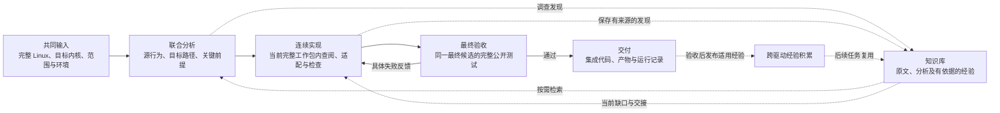

# 从自主翻译到可组织、可积累的驱动迁移

**Driver Port Factory 项目汇报｜面向企业与科研合作方**

日期：2026 年 10 月 10 日。建议汇报时长：15–20 分钟。本文为详细依据稿；主讲第 1、3.4、4.6、5.1、7、8 节，其余问题拆解供飞书阅读与追问，不必逐页讲述。

版本口径：v1 为早期 Driver Port Factory，v2 为 Driver Port Lab，v3 为当前用于对照实验的 Driver Port Factory。独立的 relational 原型不纳入本次演进线。v1、v2 均属于本项目未发表的研究探索。

**论证规则。** 本文先读过程，再核对对应代码、实际提示和进度规则。一次模型遗漏不是架构必然失败：若规则已经覆盖、只是该轮未落实，记为执行波动；若控制器确实没有承接相应关系，或明确的状态更新顺序造成重复选择，才陈述为已确认的机制缺口。阶段组织带来的反馈距离属于设计取舍，不直接判为缺陷。附录 D 将这些判断分别列出，不从个例推算失败频率。

## 1. 我们发现的问题：会生成驱动代码，仍需要组织完整迁移

我们的目标是将 Linux C 驱动迁移到星绽 Rust 内核，让目标系统真正使用设备，并保持声明范围内的源行为。

观察多个驱动的翻译过程后，我们关注到一个具体问题：**模型能够理解源码、生成设备实现，但实现和修复期间仍可能丢失跨边界的联系：设备与调用者的职责、源与目标的数据方向、组合条件下的协议布局，以及正常操作与恢复路径共享的资源。** 运行观察本身也可能接错，带偏后续修复。这些问题影响真实迁移质量，费用与时长是其后果之一。

迁移需要把设备协议、源内核上下文、目标框架、实现目标和验证结果连接起来。具体错误可能来自模型波动；专门框架的设计动机是将这些联系持续组织进当前工作，而非宣称通用模型不能理解它们。成本用来衡量这条路径的实际开销。

### 1.1 观察一：实现了设备逻辑，运行时才发现上层没有接通

在一份纯 Codex＋goal 的 VirtIO RNG 翻译会话中，我们核对到以下过程：

| 顺序 | 模型的实际工作与反馈 | 说明什么 |
| --- | --- | --- |
| 1 | 查阅 Linux RNG 驱动、目标设备接口及公开测试 | 模型已经获得源码和调用背景 |
| 2 | 实现熵设备、请求队列和完成通知，接入设备分发 | 局部设备逻辑已经形成 |
| 3 | 首次运行 RNG 测试，反馈设备节点不存在，测试跳过 | 设备实现尚未形成完整的上层调用路径 |
| 4 | 模型发现上层设备模块没有重新接入初始化路径，补上注册 | 缺口在实际运行后被定位 |
| 5 | 再次运行，15 个公开测试函数通过 | Codex 能修复并完成任务；问题是接入缺口发现得较晚 |

我们由此提出：**先把“设备如何发现、驱动如何初始化、上层如何调用”组织成完整目标，可以帮助实现者持续关注端到端接入。** 只列设备文件或辅助函数，不能充分表达这个目标。

原会话的 goal 与任务提示已经要求真实注册、语义保持，并明确“设备不可用跳过不能通过”。因此，此例是模型在已有要求下的一次遗漏；我们不据此宣称 Codex 架构缺失注册要求。V3 改变的是要求如何被展开为接入路线、关联承担者并持续投递，而不是首次告诉模型“要能运行”。【E1、D1】

### 1.2 观察二：驱动测试通过后，执行范围继续扩张

同一会话随后出现以下动作：

1. RNG 测试通过后，模型主动运行 NVMe、块设备和文件系统测试，说明是为了检查保留子系统的回归。
2. 将多个测试拼入启动参数，遇到启动命令解析错误，随后改为逐个运行。
3. 使用普通 Cargo 静态检查，遇到目标内核构建配置错误，再查阅正确执行方式。
4. 将 RNG 测试重复三轮，说明是为了检查稳定性。

这些检查有各自的考虑，不能全部记为无效工作。但过程表明：**通用 agent 同时决定迁移设计、工具执行、检查范围和停止时机，当前目标可能延伸到其他设备与运行基础设施。** 专门框架可以将任务范围、执行入口和最终验收明确组织起来。

> 时间说明：这份 Codex 日志来自后来的对照实验，用于验证研究中关注的问题。它不是早期 v1 设计时已经存在的日志。汇报按问题和方法组织演进，具体证据保留实际日期。

### 1.3 更深入的观察：设备能用，源调用者的行为仍可能未迁移

另一份 Sol RNG 会话中，设备节点恢复后，多项测试已通过，但“先读取 1 字节，再进行非阻塞读取”的场景失败。模型随后发现：Linux 的共享 hwrng 核心先向缓存读取完整驱动缓冲，再服务小用户读取；目标最初直接按用户长度消耗设备缓冲，补充请求的时机不同。模型修正目标调用者缓存，后来通过。

这说明**用户可见行为由驱动与内核共享核心共同提供，保留目标前端不代表它天然保持源前端的责任。** 我们核对了 Linux `core.c` 的缓存条件与当时补丁，而非只依据模型的自我解释。实际 V3 RNG 分析把调用者等待、非阻塞结果与设备补充请求关联到同一完整包；这证明责任组织方式存在，不冒称全部缓存条件已被自动发现。【新过程审计 P2】

### 1.4 更深入的观察：接口映射和协议适配不能凭表面对应

Luna Network 会话发生了两种可以由定义直接核实的中间错误：

1. Linux RX 使用名称含 `inbuf` 的接口；目标队列以设备视角定义 input/output。模型最初将 RX 和 TX 的描述符方向都接反，实际流量诊断后分别修正。目标队列 WRITE 标志与原补丁提供直接依据。
2. 模型因 QEMU 关闭合并接收缓冲而选择 10 字节头，后来才核对到 Linux 判定为 `MRG_RXBUF || VERSION_1`；冻结的 modern 设备即使关闭合并缓冲，也需要 12 字节头。补丁据此修正。

这不是“未要求语义一致”，原提示已经要求。它说明**相似 API 名称或单个 feature 不能代表完整条件与保证。** V3 将关键源条件、目标承担者和适配前提写在同一分析中，并直接交给当前包。关系检查保证已声明项的关联与依据，模型仍需正确识别原条件。【新过程审计 P3、P4】

### 1.5 更深入的观察：修复一条路径，可能破坏另一条路径

Sol NVMe 在公开测试通过后补恢复语义，新增的控制器重初始化使用正常写入的 DMA 页承接 Identify 结果，错误后又重试原写命令。这会形成“写数据被识别数据覆盖，再重试”的静态违反路径。模型后来发现并分离缓冲，最终修正。

这说明**正常操作、失败恢复和资源生命周期需要共同维护条件，不能将局部功能完成当作相互无影响。** V3 把必要恢复和清理放进拥有完整目标的包，重大路线／前提修订参与包依据及显式依赖协调。此案例没有故障注入，不能说已实际观测到磁盘损坏，也不能说 V3 自动证明所有跨路径关系。【新过程审计 P5】

### 1.6 更深入的观察：错误的运行观察，会使诊断反过来修改正确路径

已登记且最终成功的 Sol Network 会话中，模型调查 UDP 丢包时，自写脚本只观察 OSDK stdout，未观察实际串口日志。模型把日志停在 `/init` 当作服务没启动，期间调整、回退初始化顺序，并构建早先候选作对照；后来修正日志观察才确认服务一直在运行。

这是测试接入与输出约定的错误，而非 Docker 不可用。该诊断区间约 20 分 27 秒，包含正常调查、错误观察与构建，不能全部记为浪费。V3 预置执行入口、串口通道与固定套件，将这条证据链交由程序承接；这属于完整系统与执行工具的优势，不单独算作语义方法的因果收益。【新过程审计 P6】

### 1.7 怎样使用这些证据

上述中间错误不少最终修好了。因此，汇报应同时承认 Codex 的修复能力，并解释为什么将关键联系提前组织与持续投递有价值。注册遗漏另在 Sol RNG、Sol NVMe 中出现，说明不只存在一条 RNG 特例；仍不能据现有定向审计给出发生率。

还有一项必须保留的验证边界：Luna NVMe 修复公开 64 KiB 请求后，最终仍遗漏 PRP2 的两页直接地址分支，私密 8 KiB 失败；同批 Factory 也失败。这个案例证明测试覆盖不能替代源条件，但不能被包装成 V3 的胜出案例。

八项过程观察、原日志物理行号、补丁、源／目标定义及 V3 处理逐项见[Codex 翻译过程深入核对](CODEX_TRANSLATION_PROCESS_AUDIT.zh-CN.md)。不修改或重跑已有实验。

## 2. 为什么驱动迁移需要处理这些联系

Linux 驱动依赖设备，也依赖所在内核。移到星绽后，设备协议通常仍需遵守，但注册、请求处理、同步、资源管理和上层调用的承担方式会变化。

| 必须回答的问题 | 为什么影响迁移 |
| --- | --- |
| 源驱动在什么条件下必须发生或不能发生什么？ | 提前返回、非阻塞、失败清理等条件会影响可观察行为 |
| 这些行为由源驱动还是源内核框架保证？ | 单看驱动入口，可能漏掉调用者或共享核心的责任 |
| 在目标平台中，谁接管这些责任？ | 使用相似接口，还需要核对其调用条件和实际保证 |
| 设备实现怎样到达上层使用者？ | 模块可以编译，但仍需要真实注册和调用路径 |
| 哪些检查支持本次交付？ | 构建、启动、设备操作分别回答不同问题 |

我们据此建立迁移要求：明确范围，以固定版本的源实现及相关上下文、必要设备资料和目标框架定义为依据。目标可以采用不同的数据结构与组织方式，但需要解释行为责任如何保持。

**功能对齐**回答“需要完成哪些能力”；**语义对齐**回答“这些能力在什么条件下成立”。公开测试提供实际观察，不能自行决定或缩小源行为范围。

## 3. v1：用知识、契约和阶段交付管理迁移

### 3.1 v1 的回应

v1 将迁移组织为资料与知识库准备、目标平台研究、迁移契约、框架补齐、驱动实现、产物准备和运行验证。控制器保存输入、交付物、进度与执行证据。

它建立了三项基础能力：

1. **要求明确。** 从源行为形成迁移约定，实现和验收有共同依据。
2. **知识可定位。** 平台资料和源码进入知识库，判断可以回到原文核对。
3. **过程可追溯。** 研究、实现、运行及返修都有记录，模型交回与实际验收分开。

### 3.2 实验过程暴露的新问题

我们重新读取归档的 NE2000 原始会话，发现前期研究与编码发现之间仍存在距离：

1. 目标研究进行了知识检索和原文核对，识别接收缓冲区写入能力、中断路由等缺口。
2. 补充资料后，研究阶段以“具备约束条件的就绪”结束，部分设计问题继续保留。
3. 实现阶段进一步发现端口访问宽度、PCI 使能顺序等具体问题。
4. 模型调整原实现方案，并修改相关框架接口。

这里的知识库发挥了定位作用。真正暴露的问题是：**全面前置调查也不能一次穷尽实现需要的信息；新的知识需求会随着编码产生。** 因而需要明确哪些问题值得提前解决，哪些应在实际实现中查证。

同一任务还显示了阶段交接推迟完整反馈的过程：

1. 驱动实现阶段完成静态检查和内核单元测试，报告注明真实设备运行尚未完成。
2. 产物阶段继续补齐运行接口、构建和打包。
3. 实际启动后，发现测试接入的绑定地址不适用于目标环境。
4. 修正接入、重新构建后，才完成端到端运行。

E1000 的历史复盘也记录了：首次实现没有补齐冻结测试需要的入口，公开验证阶段再返回实现阶段处理。最终成功案例证明 v1 能完成实质工作，同时说明多阶段准备没有消除后期反馈与返工。

### 3.3 从过程追到根因：阶段就绪与迁移就绪不是同一件事

NE2000 的研究报告没有隐瞒缺口：第二次研究明确说知识库已经有 349 个片段、118 个目标片段，同时仍有接收缓冲填充和 PCI 中断路由问题。实现后来又发现访问宽度与 PCI 使能顺序。因此，问题不能归结为“没有认真调查”或“知识库没有实现”。**资料可检索、报告可交付，仍不等于选定接入路径的必要前提已经成立。**【E2】

这暴露了两个组织上的原因：

1. **前置调查按平台主题生产资料，实施按具体路径消费资料。** 前者容易回答“接口有哪些”，后者需要回答“按这个顺序执行，这个保证是否成立”。宽度与使能顺序只有放到具体访问路径中才成为必须回答的问题。扩大资料量不能代替这种联系。
2. **交付边界按工程活动划分，反馈边界按设备能力出现。** 驱动实现可以完成静态检查和局部测试，真实设备路径留到产物阶段才运行；此前没有运行的接入条件就会延后暴露。NE2000 的绑定地址问题属于测试接入，不能误记为驱动算法错误，但它同样延迟了实际设备反馈。【E2、E3】

历史代码进一步限定了判断：v1 的目标研究服务将同一报告登记到 profile、API evidence、trace、change plan 等角色，交付校验主要检查文本和产物；主控制器再向实施提供这些角色的导航，实施快照与产物准备分别处理。这个组织确实按活动和产物分边界，但它已经允许资料复用、条件化研究和修复。**不能因为研究后又有新发现就判定 v1 错了；成立的改进动机是让关键前提和完整设备反馈更直接地参与实施。** 历史归档没有启动代码副本，相关 Git 版本作为同期结构核对，不冒充运行精确版本。【H1、D2】

E1000 的审计还记录了另一条链路：前期批量读取产生截断，后期上下文压缩后重新寻找执行方式；普通 Cargo 检查和正确内核构建路线混用，最终产物检查才发现代码没有实际链接。其根因是**成功配方、当前结论与历史会话之间缺少稳定的消费入口**。这类问题应由可复用知识和执行基础设施承接，不能要求模型每次从历史中重建。【E3】

### 3.4 为什么提出 v2

**v1→v2 的动机是缩短实现与有效反馈之间的距离。** 同一设备能力需要的适配、实现、接入和检查，适合围绕完整目标一起推进。前期只解决主要路径及关键未知，局部细节随着实现按需调查。

“费用高”是上述组织方式的工程后果之一。汇报应先讲重复理解和跨阶段反馈怎样发生，再展示其费用。

## 4. v2：以完整目标为中心连续实现

### 4.1 v2 的回应

v2 将主要工作集中为三个宏观阶段：**轻量分析、持续实现、最终验收**。实现者在当前工作目标内连续查阅源码、适配接口、写代码、集成、检查和修复；普通操作由程序管理。

主路径中的注册、初始化、请求、完成和清理，可以共同属于一个工作包。一个小驱动可以只有一个完整目标。这样让紧密关联的状态和生命周期在同一上下文中处理。

### 4.2 第一个本质问题：执行目标传下去了，源行为的成立条件没有同样稳定地传下去

pvpanic 的一次运行提供了清楚的过程证据：

| 顺序 | 日志中核对到的事实 | 传递中的变化 |
| --- | --- | --- |
| 1 | 分析读取源代码，返回文本明确包含“锁获取失败立即返回” | 关键条件已经进入分析会话 |
| 2 | 分析概括为“共享状态由锁保护，通知串行执行” | 保留了互斥意图，未明确保留获取失败时的行为 |
| 3 | 实现核对目标接口，采用等待获取锁的实现 | “立即返回”的要求没有落实到目标机制 |
| 4 | 编译检查反馈缺少接口导入，模型修复 | 工具有效反馈了编译问题 |
| 5 | 事件和关机串行测试通过 | 测试没有制造锁竞争，未反馈前面的行为差异 |

继续核对实际输入后，因果链更清楚：当时分析提示要求写简短路线、重要决定和下一步，没有要求将每项关键条件连接到承担它的目标；实现回合收到这份分析和公开要求，再按具体缺口读取原文。实现日志主要核对目标接口，没有重新读取这条源锁分支。于是“已经读到的条件”并没有成为“当前实现必须保留的要求”。【E4】

这不是工作包太小的问题：把整个驱动放进一个包，也不能自动恢复摘要中已经丢失的条件。**工作包解决“现在完成什么”；还需要说明“为什么这样做，以及成立条件是什么”。** 将互斥当成完整同步语义，会把获取失败、提前返回和进展条件丢在执行目标之外。

本次未执行竞争场景的动态复现；确认的是源与目标代码的条件差异。该例发生在 9 月 30 日的简化交接路线。后来的 v2 已加入责任关联，不能把这一例扩写成“整个 v2 从未支持语义责任”。它支持的是：轻量交接必须同时保留迁移决定及依据，不能只保留路线摘要。【E4、E7】

### 4.3 第二个本质问题：把遗漏交给最后的审阅，不能稳定替代前面的责任传递

v2 随后尝试加入责任提示与最终语义审阅。两次只读诊断显示：

1. 第一轮审阅读取源通知路径和目标同步机制，却仍把“锁串行化状态”判断为支持；它报告缺少运行证据、写失败行为未知，没有指出获取锁条件的差异。
2. 提示明确要求比较源条件和提前返回后，第二轮才指出源 `spin_trylock` 与目标阻塞锁不一致。
3. 第一轮输出把正文写进引用字段，并重复责任标识；第二轮省略未知项的空引用字段，旧解析器再次拒绝。第二轮随后离线重解析，未再调用模型，保留了真实发现。【E7】

因此，**事后审阅的检测能力和交付格式是另外两个不确定环节，不能把 reviewer 当作前期信息遗漏的可靠兜底。** 第二轮诊断是已知开发案例上的提示调整，不是独立盲测；它证明一种差异可以被发现，不证明所有差异都会被发现。

### 4.4 第三个本质问题：新增知识、改变设计和修改实现进度需要区分

10 月 2 日的另一次 pvpanic 运行中，模型已经修复编译问题并获得事件检查通过，随后更新责任正文，控制器再次核对当前项；重复检查遇到工具链 manifest 的 TLS 下载失败，流程停止。候选源码的检查点记录允许核对这一过程。【E8】

不能把 TLS 故障说成语义机制导致的代码错误。它揭示的是：**说明和证据更新若与实现目标的改变使用同一套失效规则，会额外制造工作，即使已有代码应继续保留。** 同样，包间只知道“先做 A 再做 B”还不足以解释“某个共同设计前提改变后，哪些包需要核对”。需要把进度关联到明确的设计依据，并区分仅追加证据和真正改变路线。

代码核对发现了具体更新顺序：v2 的回合末已读取新计划，但完成记录写入的是回合开始选中的旧单元 key，然后才替换计划。责任正文进入单元依据；在该轮修改正文后，新旧 key 不同，下一次会重新选中该目标。E8 的第 59 行记录旧 key 完成，第 61 行就以新 key 重选 `events`，与上述机制相符。该责任修改不是单纯追加引用，不能误称“任何元数据修改都会返工”；可以确认的是**同目标在当前回合已经更新依据时，旧 key 完成没有同步协调到新 key**。【E8、H3】

v2 本来就有前置依赖、循环归组和计划修订，后续还支持责任进入工作包；这里不能说 v3 首次发明了这些能力。v3 的推进是把源要求、路线、关键前提的关系统一用于交接与进度协调，并提供同目标当前回合的协调处理。【E8、M1、M4】

### 4.5 重复检查与轮询：伴随问题，不能冒充架构创新

同一运行先分别检查事件和关机，再由模型运行完整检查，随后控制器再次运行完整检查。原生轨迹还记录了 13 次轮询，其中 9 次返回空输出。

这说明宏观阶段简化后，检查执行与最终验收仍需要统一管理。模型适合处理具体诊断，程序适合等待执行、保存观察及应用验收规则。v2 后续已有受控检查与复用改进，v3 沿用并进一步接到固定实验入口。这是工程支撑，不单列为 v3 独有的方法贡献。【E4、M5】

### 4.6 为什么进一步形成 v3

**v2→v3 的动机是：让“执行什么”与“依据什么、在什么条件下成立”共同贯穿迁移。** 保留连续实现，同时连接源要求、目标承担者、接入路线、关键前提、知识和工作包；同一组联系用于调查、交接和修订。末尾通过独立执行取得运行证据，不依赖一个模型 reviewer 为整个方法背书。

这也是对 v2 后期探索的整合与推进，不是“v2 只有调度、完全没有语义”。后期 v2 已尝试责任关联、自检、受控检查和独立审阅。V3 的具体增量要落到联合分析、明确前提、报告检索、条件化知识发布和当前回合修订协调上；不能把已有能力更名后算作新贡献。

版本演进因此有明确逻辑：Codex 的过程显示局部实现与全局接入、停止范围可能脱节；v1 用资料和阶段管理它们，却留下前置生产与后期反馈的距离；v2 缩短实现反馈距离，却需要更稳定地传递迁移依据。v3 将这两条线共同组织起来。下节逐个回答这些问题。

## 5. v3：连接行为责任、实现目标和知识传递

当前 Factory 将 v1 的知识与依据组织、v2 的连续实现经验结合起来，用同一套关系连接分析、执行和验收。

### 5.1 顶层流程

图中的动作不代表一次必需模型调用。知识查询发生在具体信息缺口处，经验发布不要求另开总结阶段。最终验收由控制器管理；当前默认不启用独立模型 reviewer。

### 5.2 回答问题一：为什么设备逻辑做出来了，上层仍可能没有接通？

**问题来源。** Codex RNG 在会话前段已经读过上层调用者与初始化文件，仍在首次运行时出现 `/dev/hwrng` 不存在；之后才补调用者初始化。缺口不是缺少源码，而是已有事实没有被组织成持续可见的完整交付目标。【E1】

**V3 如何处理。**

1. 分析从源入口和共享核心识别必需能力，同时读取目标上层调用者，确定能力最终在哪里被使用。
2. 将设备发现、驱动初始化、注册发布和上层调用组织成一条接入路线，明确每个断点的承担者。
3. 让工作包覆盖这条完整路线；注册和上层接入不作为等待其他阶段处理的剩余事项。
4. 公开验收判断真实设备行为；设备不可用导致的跳过不能作为通过。【M1、M2、M5】

**实际对应。** V3 RNG 的 P1 查到四个关联事实：调用者文件已存在，但设备模块缺失、设备分发跳过 Entropy、上层模块未声明、上层初始化未调用。R1 随后逐项给出接入位置，C1 将“设备初始化并向保留调用者发布”列为源义务，B1 同时承担设备实现和调用者接入。这正面覆盖了 Codex 会话中后来补的缺口。【E9】

**为何有效。** 它把“源码中能够查到的信息”转成“当前目标已声明的责任”，并由控制器投递。工作包提交只推进实现进度，最终设备节点与读数据的运行断言另行确认。不能由此推断模型永远不会忘记注册；可以确认该接入要求在这份实际计划中已经被提前定位和传递。

### 5.3 回答问题二：为什么前期调研很多，编码时仍发现会改变方案的条件？

**问题来源。** v1 NE2000 前期已查明缓冲区和中断问题，实施中仍发现访问宽度与使能顺序；研究完成不能保证所有实现条件已解决。【E2】

**V3 如何处理。**

1. 先根据源要求选择粗接入方向，再确定哪些未知会改变这条方向或行为结论。
2. 每个关键前提写清“待确定的事实—答案对方案的影响—依据”。不按锁、DMA、中断等主题强制全面调查。
3. 用最接近的定义与调用者回答；只有源码不足以确定关键事实时，才进行最小执行观察。没有固定探测数量。
4. 实现者在当前包内解决局部细节；发现原路线被反证时局部修订，不重新启动整个平台研究。【M1、M4】

**实际对应。** V3 pvpanic 的 P2 不是泛查“目标有没有 panic API”，而是核对终止路径和 OSTD 的 poweroff 注入机制。它发现后者是只接受第一次注入的 `Once<fn>`，从而得出具体设计后果：在原生 panic/reboot 入口增加通知，保留原终止后端；不能将通知函数当成替换的关机后端。它引用四个相关目标定义，没有为这个已由源码回答的问题额外执行探测。【E10】

**为何有效。** 调查终点由“是否足以选择并支撑当前路线”决定。V3 不要求分析预测所有局部 API 细节，因此编码中的新发现是允许发生的渐进细化。它处理了全面调查与实际使用不对应的组织问题，并未声称有限调查能穷尽全部正确性问题。

### 5.4 回答问题三：为什么实现交回了，真实设备问题却要等到产物或验收阶段？

**问题来源。** v1 NE2000 交回实现时注明真实设备路径未运行，绑定地址问题直到产物阶段才暴露；E1000 公开验证又因缺测试入口返回实现。边界按研究、框架、驱动、产物划开，实际能力却需要这些部分一起成立。【E2、E3】

**V3 如何处理。**

1. 预置官方 Docker、构建、启动与公开断言入口，基础设施准备不交给每个驱动模型重复设计。
2. 将必要框架适配、驱动实现、调用者接入和被测接口适配放进需要它们的完整工作包。
3. 在同一实施会话里构建、运行当前能力、根据具体诊断修复；包内读源码和检查不会自动产生新交接。
4. 最后控制器捕获交付并执行完整最终批次；保留独立验收，不把实现者的 done 当作运行通过。【M2、M5】

**实际对应。** V3 pvpanic 的第一实施会话开始就声明实现完整 PCI、组件与 procfs 接入。第 40 行记录它在首次构建前发现并修正两个问题：总线持有设备引用可能阻止 BAR 释放；每设备事件锁可能让 panic 通知等待。第 51 行处理具体编译接口错误，第 59 行开始生命周期运行，第 65 行记录三个准备好的实际 QEMU 场景通过。设备实现、生命周期修正、编译反馈和原生接入检查均在 B1 中进行。【E10】

**为何有效。** 不再为了“框架阶段结束”单独交回一个尚未服务设备的适配，也不等待所有代码写完才首次接触运行反馈。这条机制继承 v2 的连续实现；V3 的贡献是把明确的迁移要求和设计依据一同接到这条实现路径上。历史 pvpanic 该轮收尾仍有额外检查，不能将它说成当前最短收尾路径的实测证明。

### 5.5 回答问题四：为什么已有分析和知识库，还需要重新找、重新理解？

**问题来源。** v1 有真实检索，并非“没有 RAG”；NE2000 仍在实施中提出新信息需求。E1000 审计记录截断、压缩后重找执行方式；v2 pvpanic 已读到的源条件在摘要交接中丢失。这三个现象分别涉及资料选择、发现的保存和已有内容的消费，不能用“建一个知识库”统称解决。【E2、E3、E4】

**V3 按三种信息分别处理。**

| 信息 | 如何留下 | 后续如何获得 | 已核对依据 |
| --- | --- | --- | --- |
| 当前包必须执行的源要求、路线与关键前提 | 同一联合分析中的正文与关系索引 | 控制器按当前包直接投递相关原段落及源码位置，不再让另一个模型重写摘要 | `route_model.packet`、实际 C2→B1 关系【M1、E10】 |
| 当前问题需要的原文和已接受分析 | 固定版本源码索引；已接受报告保存在不可变产物中 | 任务 RAG 检索原文；问题证据包同时查询源要求、源代码、目标代码和测试，并沿明确引用定位原文 | `problem_packet.accepted_rows/query/assemble`【M3】 |
| 可用于其他驱动的分析或实施发现 | 分析选择有依据的前提；实施通过已有工具保存经验、条件和来源 | 共享库按版本、平台和当前问题检索，展开证据后核对适用性 | `route_learning`、`learning`、共享库说明【M3】 |

这三条路径目的不同。**必须落实的责任使用确定性投递，当前缺口使用检索，跨驱动经验使用有条件的复用。** 如果将所有责任都交给检索命中决定，就仍有“找不到或未查询”的交接风险；如果每轮塞入全部资料，又恢复 v1 的阅读负担。

共享经验保存解释、适用条件、限制及所引原始字节。分析中的选定前提可以直接复用已有段落发布；实施发现先归档，公开验收后发布，不增加固定总结阶段。错误解释不会因发布而成为真理，后续工作者仍核对相关定义。【M3】

**为何有效、证据到哪里。** 当前实现已经把“有资料”接到“当前包必需内容”与“定向查证入口”，并提供跨任务的保存与消费链路。它解决的是信息没有稳定入口的问题。当前六驱动对照关闭外部共享，不能据这些成绩声称已测得跨驱动复用收益；也不能声称所有会话发现都会自动入库。知识库应作为重要方法点与消融点，但其效果需与“机制已实现”分别陈述。

### 5.6 回答问题五：为什么功能测试通过，源条件仍可能改变？

**问题来源。** v2 pvpanic 将非阻塞获取失败的立即返回概括成锁保护，目标改为等待锁；串行运行不会区分这两种行为。【E4】

**V3 如何处理。**

1. 对关键适配写明源触发条件和必需结果，保留提前返回、失败获取、清理与进展条件。
2. 写明目标驱动、框架或调用者分别承担哪部分，以及目标保证依赖的条件与定义。
3. 将源要求连接到工作包。控制器验证每项已声明要求有承担目标，包内直接携带该要求及来源。
4. 分别记录实际运行支持、适用的源码论证与验证限制；公开测试没有覆盖某条件，不会把该条件从源要求中删除。【M1、M2】

**实际对应。** V3 pvpanic 的 C2 明确写“实例列表锁被占用时不得等待，并抑制通知”，索引将 C2 关联 B1。候选的通知分发采用 `try_lock`，失败直接返回；事件 mask 使用原子变量，避免再由每设备锁引入等待。实施日志第 40 行明确记录第二层等待风险及修正。因此该例可以追到“源条件—分析—包关联—生产实现”，比“要求模型注意并发安全”具体得多。【E10】

RNG 则说明责任不一定全在驱动：其 C5 从 Linux 驱动 `wait=false` 与共享 hwrng 核心的错误映射出发，指出目标驱动返回是否有数据，保留调用者将无数据转换为 `EAGAIN`。C4 将等待交给目标调用者，完成通知由驱动唤醒。这样保持的是协作后的行为，而非逐个复制 Linux 函数。【E9】

**为何有效。** V3 将“功能存在”和“功能在指定条件下成立”分别说明，并让当前目标共同承担。控制器验证关联与出处，模型判断适配和代码；程序不凭 JSON、引用或哈希证明语义等价。已确认的是上述具体条件进入实现，不能把这一个案例外推为全部源语义已覆盖。

### 5.7 回答问题六：为什么增加 reviewer 仍不能稳定发现问题，还可能增加返工？

**问题来源。** v2 第一轮只读审阅遗漏实际锁差异，却提出运行证据和写失败方面的未知；第二轮才发现差异，格式又引发拒绝。检测、问题定性和元数据处理都需要成本。【E7】

**V3 如何处理。**

1. 将条件与承担关系放到实施前和当前包，模型按源要求自检；默认不增加独立模型 reviewer。
2. 有预置公开套件时，分析不能自行增加必跑的压力、故障注入或辅助测试。验收集合由操作者决定。
3. 未被运行覆盖的要求保留有界源码论证及限制；“未穷尽验证”不会自动生成新实施任务。
4. 若必要事实的真假会改变正确性结论，写出具体问题和解决入口；实际失败或明确违反路径才进入对应处理。结构错误在同一次提交中返回并修正，不要求重启研究或另写语义报告。【M1、M2】

**具体作用。** 对 pvpanic 非阻塞要求，实施者已经拿到 C2，不必等最终 reviewer 从完整源码重新发现。对 RNG 生命周期要求，实际报告 C7 明确没有相应运行场景，单独陈述源码解释和限制，而没有把“再做全套故障测试”设成完成条件。【E9、E10】

需要区分证据版本：10 月 3 日运行用于证明责任进入代码；当前提示与执行代码用于说明预置验收集合及收尾规则。不同版本的证据不能合并成“该历史运行已经验证全部当前规则”的结论。【E10、M1】

**为何有效。** 将能提前表达的责任前移，并限定什么证据需要返修，去掉“不断审阅，总能提出一点新要求”的默认循环。它不自动证明每次模型自检都正确；运行通过与语义解释仍是不同证据。

### 5.8 回答问题七：改一个工作包，会不会漏掉影响？为什么又不全部重做？

**问题来源。** v1 分阶段反馈涉及重新交接；v2 已有依赖协调，但责任正文更新曾导致当前项重新核对。问题不是没有依赖图，而是需要区分行为要求、设计依据与证据的变化。【E2、E8】

**V3 如何处理。**

1. 一个包关联承担的源要求、采用的路线、路线依赖的关键前提，并可声明前置包。
2. 进度依据包含相关要求与设计正文；共享路线或前提正文改变时，关联包的依据会改变。前置包依据的变化通过显式依赖传递。
3. 仅增加来源或探测收据元数据不改变设计依据，不因此重置实现进度。若改动了说明正文，系统不靠文字相似度猜测“语义没变”。
4. 当前回合修正了路线、但完整目标及依赖没有改变时，允许继续在当前包完成，不强制再交回一轮确认。源要求和公开 oracle 不能用局部路线修订削弱；需要正式处理的范围问题走原修复协议。【M4】

**为何有效。** 同一份联系既决定当前上下文，也决定显式设计变化的核对范围。保留源代码，核对受影响目标，并不意味着重新生成它们。未声明关系不能当作“绝对独立”的证明，最终仍运行整个交付的固定公开套件。

这项是已核对实现的机制解释；当前选择的三个实际驱动均为单包，不能拿它们证明复杂多包修订的成本收益。它与 v2 已有调度共同构成渐进改进，不应包装成 v3 独创的依赖分析算法。

### 5.9 回答问题八：为什么执行配方、反复检查和收尾会占用模型？

**问题来源。** Codex 在 RNG 成功后扩大到其他子系统，并先用不适合内核的普通静态检查；v1 E1000 的正确命令在压缩后需要恢复；v2 有空轮询、模型完整检查后控制器再检查的记录。【E1、E3、E4】

**V3 如何处理。**

1. 固定并提供适用的 Docker、OSDK、固件和设备路线，模型通过受控执行入口等待构建与运行，相关失败输出用于当前修复。
2. 预置断言和完整用例集合，适配被测接口可以由实施者完成，测试范围不由它每轮重设计。
3. 开发检查保留通过观察，不因会话、日志或临时路径更新要求模型重跑；这些记录不拼接成最终验收。
4. 收尾在同一最终生产源码与产物上完整执行必需公开集合。完整通过批次恢复时直接复用；临时日志路径不是候选版本。完成后不增加模型审阅或额外运行。【M2、M5】

**为何有效。** 把“确定执行路线、保存观察、判断套件完整”交给程序，模型继续负责技术判断与具体修复。当前公开执行代码显式保存最终源码与产物身份，最终批次禁用逐例历史复用，并检查批次中没有换候选。这回应的是收尾证据的组织问题，不能承诺模型绝不会自行调用额外 shell，也不把所有历史复测都判为浪费。

## 6. 为什么工作包这样划分

**工作包是一个完整实现目标及其相关责任。** 同一个包可以涉及多个函数、多个文件和多项源行为，并在持续会话中完成多个回合。

划分遵循以下标准：

1. 共同建立同一能力、共享紧密状态和生命周期的内容，优先合并。
2. 初始化、正常处理、失败处理和清理随所属目标一起考虑。
3. 存在较大或相对独立的完整目标，且分别管理确有帮助时，才拆分。
4. 拆分后需要说明实际前置能力、资源约定或共享设计依据。

实际已核对的三个计划如下：

| 驱动 | 工作包数量 | 关联源行为要求数量 | 包内完整目标 |
| --- | ---: | ---: | --- |
| VirtIO RNG | 1 | 7 | 熵设备注册、请求与完成、读取接入及相关生命周期 |
| VirtIO Block | 1 | 6 | 块设备协议、请求队列、上层接入与相关清理 |
| VirtIO Network | 1 | 5 | 收发队列、缓冲区管理、网络接口连接与相关清理 |

这些实际计划说明：**粗路径中的多个步骤、多项要求可以共同构成一个包。** 包的数量由目标内聚性和管理需要决定，没有按函数或阶段设置数量配额。

包间影响关系来自前置能力和共享路径、要求、前提。关系用于解释修订后的核对范围；最终集成仍通过完整验收。详细过程与真实计划依据见[工作包方法说明](WORK_PACKAGE_PLANNING.zh-CN.md)。

## 7. 已有运行效果

现有实验覆盖输入事件、随机数、块存储、网络、NVMe 和 NE2000 六个任务。以下展示 GPT-6-sol／medium 已登记的六组完成结果，便于同时看质量、时长和费用。

| 驱动 | Factory 时长／分钟 | Codex＋goal 时长／分钟 | Factory 费用／USD | Codex＋goal 费用／USD | 公开测试：Factory／Codex | 私密测试：Factory／Codex |
| --- | ---: | ---: | ---: | ---: | --- | --- |
| evbug | 12.31 | 16.59 | 1.21 | 2.93 | 3/3；3/3 | 6/6；6/6 |
| VirtIO RNG | 25.99 | 19.89 | 3.19 | 3.57 | 1/1；1/1 | 2/2；2/2 |
| VirtIO Block | 16.74 | 17.10 | 1.83 | 3.28 | 3/3；3/3 | 6/6；6/6 |
| VirtIO Network | 22.20 | 56.32 | 2.54 | 9.31 | 3/3；3/3 | 6/6；6/6 |
| NVMe PCI | 16.46 | 25.49 | 2.36 | 3.86 | 1/1；1/1 | 2/2；2/2 |
| NE2000 PCI | 24.78 | 31.76 | 3.27 | 3.91 | 3/3；3/3 | 6/6；6/6 |

两组使用各任务共同固定的完整 Linux、目标版本、官方 Docker、设备配置、模型、推理等级和公开断言，工作区分别隔离。Factory 使用自身工具，baseline 使用通用工具与上游命令，因此这里比较的是完整系统。

公开成绩按登记的用例单位统计；例如 RNG 的一个公开用例包含 15 个测试函数。私密成绩仅合并 A/B 参数变种，未将公开用例计入；这些变种不向翻译模型提供，也不用于返修。

表中时长来自已登记的端到端翻译及外部公开验收记录，私密评分另行执行。费用按记录的官方标价估算，不是中转站实付账单。该表由多个批次的完成结果组成；历史中断、重跑及版本调整保存在原记录中，不能将本表解释为所有尝试的总成本或首次成功率。

这些观察支持：**在上述版本与设备范围内，当前框架可以完成真实内核接入，在保持这组公开与私密测试成绩的情况下体现费用优势。** 六组登记完成记录的 Factory 费用均较低，五组耗时较短。它们是工程运行证据，尚不支持将整体差异单独归因于某一个部件。

当前对照保留任务内知识，关闭外部共享经验库。因此知识库的交接与积累作为方法的重要部分介绍；跨驱动共享收益与各部件因果贡献，需要按对应评价分别论证。测试成绩支持已观察场景，不能直接表述为完整语义等价。

数据源：[GPT-6-sol 六驱动成绩表](../../../driver-experiment-env/results/gpt6-sol-medium-comparison.zh-CN.md)。

## 8. V3 与 Codex＋goal 的总比较：具体问题与对应解决

比较对象是本项目已经运行的纯 Codex＋goal 配置，不是对所有 Codex 产品能力的判断。两者都依靠模型自主找代码、理解、实现和修复，均可读取固定的完整 Linux 与目标源码；baseline 提示已经包含语义、功能、范围及最终验收要求。Factory 在这一能力之上组织迁移关系、知识交接和执行边界。表中区分观察与机制：不能仅因一次遗漏就宣称通用 agent 必然存在相同缺陷。

| 对应问题 | 本次 Codex 过程说明什么 | V3 加入的处理 | 怎样核对，结论有多强 |
| --- | --- | --- | --- |
| 设备实现和上层接入脱节（问题一） | 已读调用者，首次运行仍缺 `/dev/hwrng`；运行反馈后补注册 | 接入路线、源发布义务和完整 B1 一起形成当前目标 | Codex 行 68/652/679；V3 RNG R1/C1/P1/B1。确认前置组织差异，不证明遗漏率已归零【E1、E9】 |
| 调查缺少与设计后果的明确联系（问题二） | 该会话不能单独证明所有前置调查都过量；相关根因主要由 v1 日志支撑 | 以具体前提的真假对路线的影响确定调查与停止条件 | v1 NE2000 原会话；V3 pvpanic P2 的终止机制与通知入口。避免把 v1 的问题虚构成 Codex 已观察问题【E2、E10、M1】 |
| 实现与有效反馈的边界（问题三） | 可以自行运行、修复并最终成功；检查顺序由会话决定 | 当前完整包内实现、框架适配、接入与运行；独立最终验收 | V3 pvpanic 原实施会话 3→40→51→59→65。连续实现本身继承 v2，关系组织为其提供依据【E10、M2】 |
| 已读事实和知识的后续消费（问题四） | RNG 日志显示初始化文件已读仍遗漏；不能由此说 Codex 没有会话记忆 | 必需责任直接投递；缺口检索当前原文及已接受分析；可选发布条件化经验 | 包投递、问题证据包、共享保存与检索实现。知识复用链路可检查，外部共享收益没有由本组实验测出【E1、M1、M3】 |
| 源职责跨驱动与调用者（问题五） | Sol RNG 初次直接消费驱动缓冲，未接齐 Linux core 的缓存／补充时机，后来修正 | 将驱动、调用者、框架的责任与前提共同纳入完整目标 | 原 core.c、日志 717/718/764；V3 RNG C4/C5。确认源责任问题和组织差异，不冒称缓存遗漏已经自动消除【新过程审计 P2、E9】 |
| 接口视角与协议条件（问题五） | Luna Network RX/TX 方向接反；关闭 MRG_RXBUF 时漏看 VERSION_1，后来修正 | 关键适配记录触发条件、设备读写权、目标承担者及原定义依据，直接投递 | queue.rs WRITE 标志、Linux 布局分支与原补丁；V3 RNG C2/C3 已采用条件化解释【新过程审计 P3/P4】 |
| 修复影响共享资源（问题七） | Sol NVMe 恢复新增 Identify 复用写数据页，随后自检分离缓冲 | 必要恢复与生命周期在完整包内；重大前提改变协调包依据和显式依赖 | 原补丁 750/757/862 构成静态违反链；当前修订代码可核对。不能声称自动别名分析或已完成故障注入【新过程审计 P5、M4】 |
| 错误观察带偏诊断（问题三、八） | Sol Network 自写 harness 漏读串口日志，误判服务卡死并调整候选 | 固定 Docker／OSDK 入口、串口通道、等待与日志记录 | 原补丁 2191、承认误判 2227；native_runner/runtime 的实际执行。这是完整系统的工具优势【新过程审计 P6、M5】 |
| 公开通过不覆盖全部源分支（问题五） | Luna NVMe 修好长请求，遗漏两页 PRP2，私密 8 KiB 失败 | 分开源论证和运行观察，末包源自检，独立私密评分 | 源条件与封存候选确认遗漏；同批 Factory 也失败，本案例不算 V3 已解决的质量优势【新过程审计 P7】 |
| 最终质量不靠开放式 reviewer 往返（问题六） | Codex 该轮自身完成并成功，无独立 reviewer；问题来自 v2 的审阅尝试 | 责任提前传递、模型源自检、固定公开验收；默认不增加模型 reviewer | v2 两轮只读诊断与当前提示。V3 的差别不是“多了 reviewer”【E7、M1、M2】 |
| 设计变化与工作进度如何关联（问题七） | 当前单驱动会话不能证明 Codex 必然错误处理多包影响 | 路线、前提、源要求参与包进度依据；显式依赖传播，当前同目标可继续完成 | 当前修订和调度实现；这是可解释协调机制，非已完成复杂多包因果对照【M4】 |
| 检查范围与停止时机（问题八） | RNG 成功后扩展到其他子系统、误用普通 clippy、再重复 RNG | 预置执行入口与公开集合、保留开发观察、一次最终完整批次及通过后的复用 | Codex 行 705–842；当前公开执行实现。检查集合和最终记录由程序管理，不能把历史所有重复运行都判为无效【E1、M5】 |

报告给企业方的主张可以据此具体表述为：**我们没有用另一套 agent 替代 Codex 的编程能力，而是把迁移中容易断开的联系组织成可执行、可消费、可修订的依据。** 完整接入目标回应局部实现遗漏；条件化责任回应语义摘要损失；知识消费入口回应重复定位；前提与包关系回应后续设计变化；固定执行和最终批次回应检查范围与收尾问题。

效果仍以第 7 节实际完成记录呈现。现有记录说明这套组织能用于真实迁移并表现出费用优势；过程证据解释它针对了什么，不能替代各部件因果贡献的评价。

## 附录 A：可能的追问与回答

### A1. Codex 最后也能做出来，为什么需要你们的框架？

Codex 的自主查阅、编程和修复能力是我们使用的基础。我们关注如何组织这份能力：迁移要求如何进入当前目标、知识如何交接与积累、执行范围如何管理、最终结果如何验收。过程日志展示组织问题，对照记录评价完整系统的效果。

### A2. 怎么知道你们要求的行为就是正确的？

要求来自明确范围和固定源实现及上下文，并结合必要设备资料与目标框架定义。我们区分源行为要求、目标实现选择和验证证据。目标无需复制 Linux 内部结构，但重要行为变化需要有明确依据；测试通过也不会自行扩大正确性结论。

### A3. 为什么提前分析不充分，后来又要分析？

实现会揭示新需求。前置分析先确认接入方向与会改变设计的关键事实，编码中的局部细节现场解决。有用发现继续进入任务知识，让后续工作者可以找到依据。这个组织方式来自 v1 的真实过程经验。

### A4. 为什么说工作包有意义？一个小驱动是否应该只有一个？

可以只有一个。工作包承载完整能力，多个函数与步骤共同构成目标。已核对的 RNG、Block、Network 都是单包。对于较大或相对独立的目标，才使用多包管理；划分不是唯一最优答案，而是受源要求、目标路径和依赖规则约束的规划决定。

### A5. 同一个驱动里的工作包肯定互相影响，为什么只核对部分？

共同属于一个驱动，需要最终整体集成验收。包间关系由模型根据三类事实提出：谁消费谁建立的能力、谁依赖同一共享状态或生命周期、谁依据同一目标路线或关键前提。不可分割或互为前置的内容归组；其余建立显式前置或共享依据关联。控制器不从“位于同一文件”自动推导关系。

设计修订时，关联的依据变化参与进度协调，前置变化继续传到依赖它的包；代码保留，核对不等于重写。未声明关系不等于证明绝对独立，最终完整验收补充集成观察。实际三个单包计划说明小驱动无需硬拆，不能用它们声称已验证所有复杂多包情况。【M4、E5】

### A6. 知识库有什么核心价值？

有价值的调查可以跨越会话和任务。当前任务利用它检索原文及已形成的分析，后续任务利用带条件和来源的经验定位问题。知识库减少重新定位的需求，知识的实际采纳及其质量收益应与“检索命中”分开评价。

### A7. 企业使用能得到什么？

交付物包括集成后的驱动代码、可运行产物和实际检查记录。迁移中的资料与经验可继续积累，过程能够监督，具体失败能够定位。已有六类任务提供可运行实例，合作方可以按相同输入与环境复核。

## 附录 B：过程证据定位

以下材料仅供核对，不建议在主汇报中展示日志或代码。相对路径按两个项目与实验目录位于同一父目录组织；本地运行材料不随本报告自动发布。

| 编号 | 证据与时间 | 本次读取的过程内容 | 支持的表述 |
| --- | --- | --- | --- |
| E1 | Codex RNG，2026-10-09，`deepseek-flash-medium-20261009-01` | 原生会话的源码读取、编辑、工具反馈、模型说明及后续检查 | 上层接入遗漏、测试跳过后修复、验证范围扩张 |
| E2 | v1 NE2000，2026-09 历史归档，`e2e-ne2000-audit-02` | 目标研究、实现、产物准备的原始逐项事件 | 前期研究与实现发现之间的距离，以及跨阶段反馈 |
| E3 | v1 E1000，2026-09-26 过程审计 | 调用次序、返修回执、原生对话位置及检查记录 | 测试入口后期补齐、执行配方恢复与阶段返修 |
| E4 | v2 pvpanic，2026-09-30，`pvpanic-pci-luna-20260930-08` | 分析与实现原始日志、实际分析、候选及检查事件 | 条件行为在交接中丢失、重复检查 |
| E5 | v3 工作包，2026-10-09 已运行计划 | RNG、Block、Network 的分析目标与关系记录 | 三个实际单包案例，支持粗粒度目标的解释 |
| E6 | GPT-6-sol／medium 完成结果表，2026-10-08 至 10-09 | 六组已登记成绩及批次协议 | 同条件完整系统的运行效果 |
| E7 | v2 pvpanic 两轮只读语义诊断，2026-10-02 | 原审阅输出与离线重解析结果 | 单次漏报、提示修正与协议拒绝，分别定性 |
| E8 | v2 pvpanic 责任更新运行，2026-10-02 | 旧 key 完成、新 key 重选与环境故障的原事件 | 同目标当前回合协调问题，与 TLS 故障区分 |
| E9 | V3 RNG，2026-10-09 | 实际路线、接入前提、义务与包索引 | 注册接入与调用者责任提前进入目标 |
| E10 | V3 pvpanic，2026-10-03 | 原分析、关系索引、两条实施会话和候选 | 条件与前提如何进入真实实现；不冒充同范围版本对照 |

### E1：Codex RNG 原生会话

[完整会话](../../../experiments/native-suite-current-20261006/comparisons/deepseek-flash-medium-20261009-01/virtio-rng/codex/model-home/sessions/2026/10/09/rollout-2026-10-09T18-55-26-01a1204d-b54d-7e42-8070-d83c4017e981.jsonl)。按物理行号核对：

1. 68、75：读取上层接口及公开测试。
2. 413、418：新增设备实现。
3. 645、652：发起运行，反馈设备节点缺失、测试跳过。
4. 678、679：模型说明缺失接入，补上层初始化。
5. 693、700、705：测试通过，模型随后扩展检查范围。
6. 706、720、724：多命令启动解析失败，改为分别执行其他测试。
7. 758、761、765、772：普通静态检查配置失败，查阅并切换适用命令。
8. 841、842：主动将 RNG 测试重复三轮。

### E2：v1 NE2000 原始归档

[归档文件](../../../archived-runs/history-before-audit-07.tar.gz)，本次直接读取压缩包内事件，未解压创建工作区。成员位于 `e2e-ne2000-audit-02/.dpf/codex/`：

1. `target_platform_study-53903af5-69eb-4262-bb82-ac0fb71c8ccd.events.jsonl`：第 109 行说明接收缓冲与中断路由缺口。
2. `target_platform_study-60641813-7ab7-498d-a4ec-1492c7c76014.events.jsonl`：第 38、57 行说明资料修复后保留的设计条件。
3. `driver_implementation-9e253763-0eeb-4676-8ab3-2839cd3c3a92.events.jsonl`：第 85、503 行涉及访问宽度和 PCI 使能顺序；第 797、806 行明确真实设备运行仍未完成。
4. `artifact_preparation-63284f70-4a22-48a8-bdb7-3bf7192c319c.events.jsonl`：第 94 行定位目标绑定地址问题，第 127 行说明修复后的重新构建，第 184 行说明端到端运行通过。

### E3：v1 E1000 过程审计

[完整运行复盘](../history/E1000_RUN_OPTIMIZATION_2026-09-26.zh-CN.md)、[对话级审计](../history/E1000_DIALOGUE_AUDIT_2026-09-26.zh-CN.md)、[逐阶段记录](../audits/e1000-complete-run-2026-09-26.json)。E1000 原始工作区已在历史清理中移除；此处引用保存的审计材料，不声称本次重新读取了不存在的原始工作区。

### E4：v2 pvpanic 的原始过程

1. [分析日志](../../../driver-port-lab/runs/pvpanic-pci-luna-20260930-08/commands/model-analysis-ee9f3ea8ff4a/stdout.log)：第 6、22 行的源码响应包含获取锁失败立即返回；第 20、25 行是模型的路径判断。
2. [实际分析](../../../driver-port-lab/runs/pvpanic-pci-luna-20260930-08/analysis.md)：同步条件的交接表述。
3. [实现日志](../../../driver-port-lab/runs/pvpanic-pci-luna-20260930-08/commands/model-implementation-690bd59d0a08/stdout.log)：第 18–23 行对应编译失败及修复，第 24–31 行对应分场景检查和完整检查。
4. [过程复盘](../../../driver-port-lab/docs/PVPANIC_08_WORKFLOW_RESEARCH_2026-09-30.zh-CN.md)：原生轮询计量及控制器重复检查的次序。

### E5、E6：当前方法与效果

[工作包方法与实际计划](WORK_PACKAGE_PLANNING.zh-CN.md)、[知识库机制](../knowledge/README.md)、[六驱动成绩表](../../../driver-experiment-env/results/gpt6-sol-medium-comparison.zh-CN.md)、[批次协议及中断记录](../../../driver-experiment-env/docs/experiments/GPT6_SOL_MEDIUM_BATCH.zh-CN.md)。

### E7：v2 语义审阅的两次实际诊断

1. [第一轮原始输出](../../../driver-port-lab/runs/pvpanic-semantic-review-diagnostic-20261002-01/review.md)：在 `device-capability-and-event-mask` 中将锁串行化判断为支持，未指出源获取失败返回的条件差异；同时陈述运行与写失败方面的未知。
2. [第二轮原始输出](../../../driver-port-lab/runs/pvpanic-semantic-review-diagnostic-20261002-02/review.md)：明确指出 trylock 与等待锁的差异。[未改动报告的离线重解析](../../../driver-port-lab/runs/pvpanic-semantic-review-diagnostic-20261002-02/reparsed-result.json)保留 VIOLATION 与运行证据未知，未批准交付。
3. [当时的实现与诊断记录](../../../driver-port-lab/docs/SEMANTIC_RESPONSIBILITY_2026-10-02.zh-CN.md)：区分首次遗漏、已知开发案例的提示迭代及解析改动。第一轮未指出问题是模型检测波动；格式拒绝是独立协议问题，不将两个概念混在一起。

### E8：v2 同回合更新责任后的重新选择

[原始事件](../../../driver-port-lab/runs/pvpanic-semantic-luna-20261002-04/events.jsonl)：

1. 第 34 行保存初始计划，责任 condition/mapping 段落各 1588 字符。
2. 第 54–60 行交回完成、记录新正文及旧单元 key 完成；新段落各 1515 字符。
3. 第 61 行以另一 key 重选 `events`，第 66 行再次请求检查。
4. 第 73–77 行记录下载故障、blocked 及停止。TLS 是环境问题，不属于行为不匹配。

这组记录配合 H3 的旧 key 完成顺序，支持一个具体的进度协调问题；没有将责任段落的语义变动视为纯元数据。

### E9：V3 RNG 的实际联合分析

[分析报告](../../../experiments/native-suite-current-20261006/trials/dpf/virtio-rng/deepseek-v4-pro-high-20261009-rng-01/run/work/stage-work/target_platform_study/report.md)、[关系索引](../../../experiments/native-suite-current-20261006/trials/dpf/virtio-rng/deepseek-v4-pro-high-20261009-rng-01/run/work/stage-work/target_platform_study/report.route.json)：

1. R1/P1 明确设备模块、初始化分发与上层调用者接入位置；B1 包含整个熵设备目标。
2. C4/C5 区分目标驱动提供数据、调用者等待及错误映射的责任。
3. C7 明确生命周期论证没有对应运行用例，不能作为执行观察。

这是实际分析中关系的存在与内容证据，不单凭分析正文判定最终全部语义成立。也不将它与不同模型的 Codex RNG 做单例因果性能比较。

### E10：V3 pvpanic 的“分析—实施—候选”链

1. [联合分析](../../../experiments/pvpanic-route-sol-medium-20261003-09/run/work/stage-work/target_platform_study/report.md)：C2 明确非阻塞竞争条件，P2 说明原终止后端的保证与通知接入决策。
2. [关系索引](../../../experiments/pvpanic-route-sol-medium-20261003-09/run/work/stage-work/target_platform_study/report.route.json)：B1 关联 C1–C5 和 R1，P2 关联 R1；C2 引用 Linux 源通知路径。
3. [第一实施会话](../../../experiments/pvpanic-route-sol-medium-20261003-09/run/.dpf/codex/driver_implementation-41c0f125-f06e-4534-82aa-2fbf126ed382.events.jsonl)：第 3 行从 B1 开始；第 34 行说明非阻塞实现；第 40 行记录 BAR 存活与 per-device 锁风险的自检和修正；第 51、59、65 行分别记录编译修正与运行反馈。
4. [生产候选](../../../experiments/pvpanic-route-sol-medium-20261003-09/run/work/target/kernel/core/comps/pvpanic/src/lib.rs)：`dispatch` 第 136 行起使用非阻塞获取；失败直接返回。第 301 行起有持锁不写事件的局部测试定义。
5. [后续交付会话](../../../experiments/pvpanic-route-sol-medium-20261003-09/run/.dpf/codex/driver_implementation-299fbfa1-bc30-4307-aa4f-3d1bb64a6a67.events.jsonl)：第 71 行运行反馈五项局部测试通过；它们只支持被测局部逻辑，不是全部真实竞争情形。

9 月 30 日 v2 是较窄的回调边界，10 月 3 日 Factory 是原生接入与更多生命周期要求。本文仅对照两者均涉及的获取失败返回条件及信息传递方式，不以它们计算同范围质量或费用提升。

### M1–M5：V3 当前机制核对入口

核对代码：Factory 主分支 `53e959c344b09d765394261deb342f15e433fee3`。以下是当前机制，历史运行的具体协议以其保存材料为准。

| 编号 | 当前入口 | 本次核对的内容 | 不能据此推导什么 |
| --- | --- | --- | --- |
| M1 | [联合分析任务](../../src/driver_port_factory/data/prompt-packs/default/analysis-task.md)、[分析关系模型](../../src/driver_port_factory/migration/route_model.py) | 源入口/共享核心调查、关键前提停止规则、每项声明义务有承担包、supported 前提有来源、ready 不带 open 前提、当前包直接投递原段落 | 引用存在不证明论证正确；已声明关联不证明发现全部源义务 |
| M2 | [实施任务](../../src/driver_port_factory/data/prompt-packs/default/behavior-job.md)、[包投递与调度](../../src/driver_port_factory/migration/behavior.py)、[提示渲染](../../src/driver_port_factory/codex/behavior_prompt.py) | 同包完成必要适配与运行；先用既有位置、缺口才检索；正文去重投递；末包源自检与交付 | 提示规则不是所有 shell 动作的强制拦截；投递不证明实际采纳 |
| M3 | [问题证据包](../../src/driver_port_factory/knowledge/problem_packet.py)、[分析发现发布](../../src/driver_port_factory/knowledge/route_learning.py)、[实施经验保存与发布](../../src/driver_port_factory/knowledge/learning.py)、[共享知识库](../knowledge/SHARED_KNOWLEDGE.zh-CN.md)、[RAG](../knowledge/RAG.zh-CN.md) | 已接受报告与原文的定向检索；选定前提复用；经验的条件、来源、版本、归档与后续入口 | 不证明自动保存全部发现、解释为真或跨驱动成本收益已测定 |
| M4 | [路线修订](../../src/driver_port_factory/migration/route.py)、[设计依据](../../src/driver_port_factory/migration/route_model.py)、[依赖编译](../../src/driver_port_factory/migration/behavior.py) | 包依据包含路线、要求和前提正文；证据元数据不进设计依据；前置依据递归；同目标当前回合协调；不允许局部削弱源要求 | 不自动推导未声明的源码影响关系，也不自动判断正文语义等价 |
| M5 | [预置原生套件](../../src/driver_port_factory/platform/native.py)、[Docker 配方](../../src/driver_port_factory/platform/native_runner.py)、[执行器](../../src/driver_port_factory/platform/executor.py)、[开发与最终套件执行](../../src/driver_port_factory/migration/experiments.py)、[公开验收](../../src/driver_port_factory/migration/public_qemu.py) | 固定环境、等待执行、预置断言、开发观察复用、同候选最终完整批次、完整通过批次恢复复用 | 测试通过不证明全部语义；共享输入仍需结合批次协议解释公平性 |

### H1–H3：旧版本机制核对口径

1. **H1，v1 同期结构。** 读取 Git `ce92320` 的 `target_study/service.py`、`target_study/validation.py`、`migration/implementation.py` 和 `port.py`：同一报告以多个角色登记，研究校验以文本交付为主，实施快照与产物准备分别处理。归档工程建于 9 月 20 日，没有保存控制器启动代码 commit，不能声称这个提交就是整轮执行的精确版本。同期结构与原事件可共同解释设计取舍；不对该运行虚构机器校验行为。
2. **H2，v2 版本范围。** `3713975` 的 `analysis_document.load_document/document_packet` 只读取文档和可选当前导航，提示不要求义务/承担关系索引；这是 9 月 30 日简化版。`8616098` 恢复 main_route、behaviors 和显式前置调度，提示已要求考虑源框架职责。当前实验分支又有 [责任模型](../../../driver-port-lab/src/driver_port_lab/semantics.py)、[责任投递](../../../driver-port-lab/src/driver_port_lab/planning.py) 和最终语义审阅。因此，不能将简化版缺口判作所有 v2 版本都无相关能力。
3. **H3，v2 回合协调。** [实施控制循环](../../../driver-port-lab/src/driver_port_lab/runner.py) 中 `updated = load_plan(...)` 后，done 写入旧 `unit.key`，随后 `plan = updated`；[进度依据](../../../driver-port-lab/src/driver_port_lab/planning.py) 中责任 condition/mapping 参与 key。E8 的旧 key 完成、新 key 再选与代码顺序相符。这里只核对该机制，未运行任何新实验。

## 附录 C：汇报前人工核对

1. 熟悉开场案例的完整过程，能解释模型为什么修复以及什么反馈发现缺口。
2. 明确 v1、v2、v3 的版本口径与时间，不把后来对照日志说成早期设计的直接触发记录。
3. 阅读一次实际工作包，确认目标、源要求和生命周期能够对应。
4. 核对费用、时长及公开／私密测试的单位，保留批次来源和重跑说明。
5. 熟悉关键提示词的职责：前期调查做到什么程度、当前包实现什么、完成状态由谁推进、验收由谁判断。主报告不展示提示词或代码，追问时可以解释其要求。

## 附录 D：哪些可以算机制问题，哪些只能算单次波动？

| 核对项 | 日志现象 | 框架核对 | 最终判定与论文表述 |
| --- | --- | --- | --- |
| D1，Codex 注册遗漏 | Flash RNG、Sol RNG 与 Sol NVMe 在运行后补接入 | 实际 prompt/goal 已要求真实注册和禁止跳过；会话确认编译与接入的区别 | 多个案例出现同类执行遗漏，不能判整个 Codex 没有接入要求。用于说明完整目标持续投递的动机；频率未知【E1、新过程审计 P1】 |
| D2，v1 前期研究后仍有新发现 | 宽度、使能顺序在实施中查明 | 同期代码按报告角色组织调查，按实施/产物活动分别处理；精确运行代码身份未保存 | 渐进发现正常。确认组织取舍与反馈距离，不证明全面研究必然低效或 v1 普遍错误【E2、H1】 |
| D3，v2 锁条件丢失 | 已读条件，分析未明确留下，目标等待锁 | 简化版交接只有自由正文/导航，没有条件到承担目标的关系要求；后期已加入责任机制 | 当次代码差异成立；早期交接机制缺口成立；整个 v2 普遍缺陷不成立【E4、H2】 |
| D4，v2 reviewer 第一轮漏报 | 读源码仍未指出差异，第二轮提示调整后指出 | 审阅机制允许读两侧定义，后期解析器已放宽空引用；模型判断不能由程序保证 | 检测波动真实，不证明每次 reviewer 无效。格式问题独立记载，不能伪装成语义缺陷【E7】 |
| D5，v2 同目标重新选择 | done 后更新责任，旧 key 完成，新 key 被选中 | 控制循环写旧 key 后换新计划；责任正文影响 key | 具体进度协调缺口被日志与代码共同确认，V3 有同目标回合内协调处理【E8、H3、M4】 |
| D6，重复检查/范围扩张 | Codex 追加其他子系统检查，v2 存在空轮询与重复完整检查 | baseline 允许通用工具自主组织；v2 后期已有受控检查，V3 固定套件和最终批次 | 记录执行开销与组织差异，不能把所有复测视为浪费，也不把受控执行说成 v3 首创【E1、E4、M5】 |
| D7，知识复用不足 | v1 仍有后续查证；v2 条件摘要丢失 | 旧流程本来有知识导航，后期 v2 也有责任投递；V3 增加任务报告检索、直接责任投递与条件化共享保存 | 只能确认消费链路的具体改进，未证明旧知识库无效或新共享机制已产生量化收益【H1、H2、M3】 |
| D8，Codex 中间语义错误 | RNG 调用者缓存、Network 方向／头布局、NVMe 恢复缓冲曾不正确，后来修正 | 实际提示已有语义要求；原定义及补丁确认行为差异；baseline 没有 Factory 的关系投递与修订协议 | 中间执行错误成立，不能当成最终残留错误；框架差异可核对，不据此证明每次都能预防【新过程审计 P2–P5】 |
| D9，Codex 运行误诊 | Network 服务运行中，harness 漏读实际日志，改候选后才定位 | 上游输出约定、原 harness 补丁与承认误判一致；Factory 预置串口执行链 | 具体观察接入错误成立，不能判内核卡死或 Docker 不可用。V3 处理属于工具及完整系统优势【新过程审计 P6】 |
| D10，公开通过后的残留协议错误 | Luna NVMe 长请求通过、两页 PRP2 分支遗漏 | Linux/QEMU、封存候选与私密评分共同确认；同批 Factory 也失败 | 残留缺陷真实，但不能算 V3 已解决的质量优势；保留原成绩，不改候选、不重跑【新过程审计 P7】 |

本文将所有前面列出的组织问题映射到 V3 的具体处理，但不把单次波动升级为版本判负，也不把“有处理机制”升级为“全部风险彻底消失”。这样主张才与现有实验和代码证据一致。
